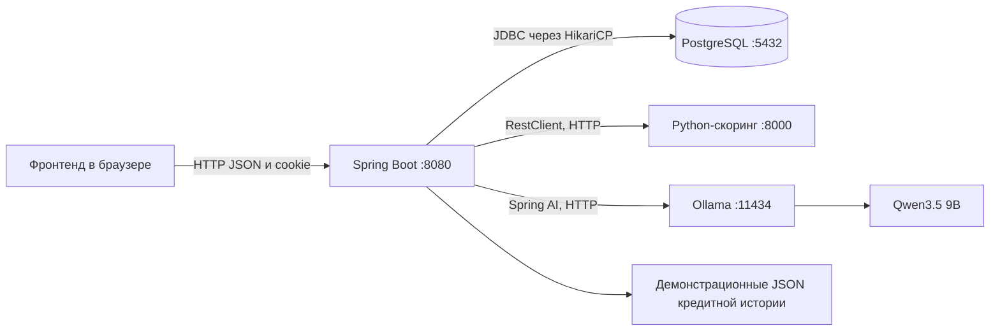
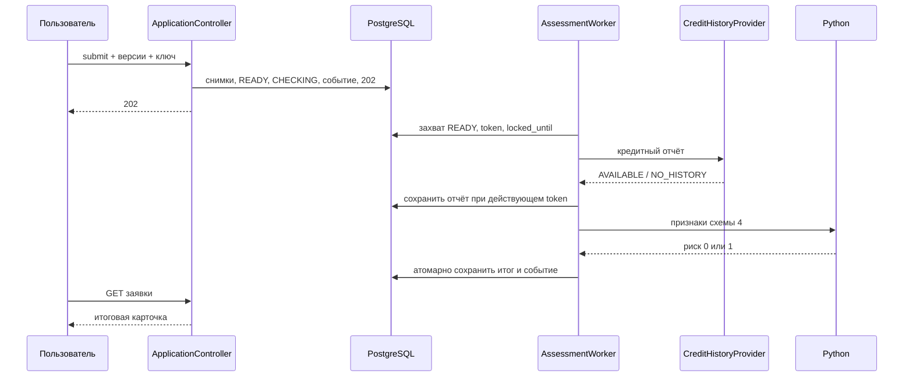
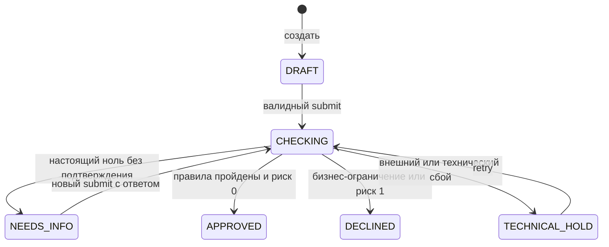
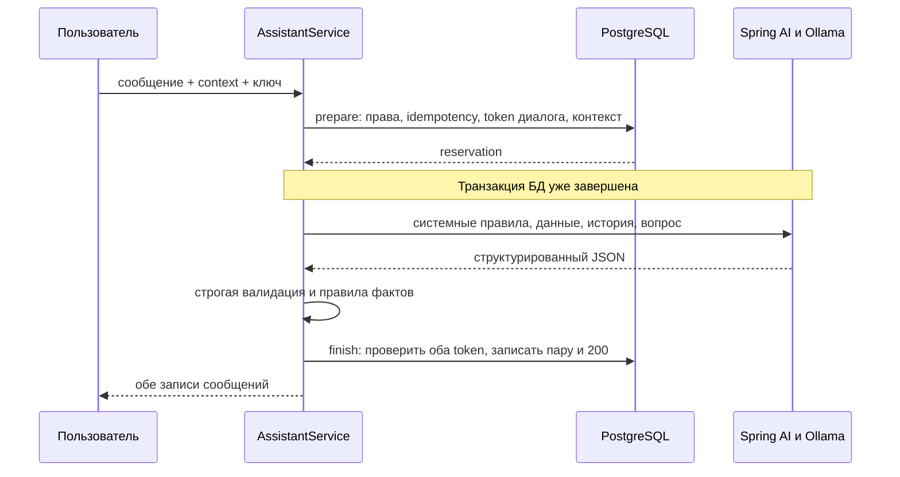

# Как устроен наш бэкенд

Быстрый маршрут: разделы 1–7 — устройство и данные; 8–12 — весь путь заявки; 13 — идемпотентность; 14–16 — помощник, модель и соединения; 17–18 — API и запуск; 19–21 — отчёт приёмки, ревью и реальные ответы модели.

## 1. Что запускается и кто за что отвечает

У решения четыре самостоятельные части: браузерный фронтенд, Java-бэкенд, Python-скоринг и Ollama с языковой моделью. Java хранит данные и принимает окончательное решение о заявке. Python выполняет формальный расчёт ликвидности. Языковая модель помогает человеку выбрать продукт и разобраться с полями.



Демонстрационные JSON кредитной истории читаются Java-провайдером. Настоящего подключения к БКИ, Альфа-Банку, движению денег или проверке банковского счёта сейчас нет. Два юридических лица, пользователи и условия продуктов являются согласованными демоданными.

Сбой Ollama влияет на чат. Каталог, форма и рассмотрение заявок работают независимо от него. Сбой Python затрагивает рассмотрение и приводит к технической остановке заявки. PostgreSQL нужен всему приложению, потому что в нём лежат и формы, и очередь, и диалоги.

### Технологии

| Компонент | Используется сейчас |
|---|---|
| Java | 21 |
| Spring Boot | 4.1.2 |
| Spring Framework | 7.0.10 |
| Hibernate | 7.4.13.Final |
| Spring AI | 2.0.2, адаптер Ollama |
| JSON | Jackson 3, пакет `tools.jackson`; аннотации `com.fasterxml.jackson.annotation` |
| База | PostgreSQL 18.6, Flyway V1–V4 |
| Maven | Wrapper 3.9.16 |
| Документация HTTP | springdoc 3.1.1, OpenAPI 0.5.0 |
| Токенизатор Qwen в Java | DJL HuggingFace tokenizers 0.36.0 |

## 2. Как ориентироваться в пакетах

| Пакет | Ответственность | С чего начать чтение |
|---|---|---|
| `identity` | Демовход, пользователь сессии, сведения компании | `IdentityService`, `SessionCurrentUserProvider` |
| `catalog` | Доступные продукты и их условия из БД | `CatalogService`, `ProductTerms` |
| `credit.api` | HTTP заявок и DTO | `ApplicationController`, `ApplicationView` |
| `credit.service` | Создать/сохранить/отправить/повторить, записать результат | `ApplicationService`, `SubmitApplicationService`, `ProcessApplicationService` |
| `credit.decision` | Проверки формы и правила кредитного решения | `SubmissionValidator`, `CreditDecisionPolicy` |
| `credit.processing` | Фоновый запуск, захват и восстановление | `AssessmentWorker`, `AssessmentClaimService`, `AssessmentRecoveryService` |
| `credit.credithistory` | Получить и проверить кредитный отчёт | `CreditHistoryService`, `DemoCreditHistoryProvider` |
| `credit.scoring` | Преобразовать данные и вызвать Python | `ScoringRequestFactory`, `HttpRiskScoringClient` |
| `assistant.api` | HTTP диалогов и сообщений | `AssistantController` |
| `assistant.service` | Права, контекст, две фазы отправки, история | `AssistantService`, `AssistantStateService`, `AssistantContextFactory` |
| `assistant.integration` | Промпт, Spring AI/Ollama и проверка фактов | `OllamaAssistantGateway`, `AssistantPromptBuilder`, `AssistantGrounding` |
| `common.idempotency` | Повтор команды без повторного эффекта | `IdempotencyService` |
| `common.error` | Общий формат ошибок HTTP | `ApiExceptionHandler`, `ApiProblemFactory` |
| `common.json` | Формат сумм и процентов в JSON | `MoneyJson`, сериализатор и десериализатор |
| `config` | Spring Security, JSON, время, внешние клиенты, фоновые параметры | `SecurityConfig`, `JsonConfig`, `AssistantConfig`, `ScoringConfig` |

Внутри функционального пакета `api` принимает запрос, `service` выполняет сценарий, `model` содержит данные, а `persistence` читает и записывает БД. Отдельного HTTP-сервера на каждый пакет нет: всё это один Java-процесс.

Контроллер не должен собирать кредитную политику, а репозиторий — решать, одобрять ли заявку. Такое разделение позволяет читать один сценарий сверху вниз, не смешивая JSON, SQL и бизнес-правила в одном методе.

## 3. Что происходит при запуске Java

1. `CreditCabinetApplication` запускает Spring Boot, находит конфигурацию и компоненты под корневым пакетом.
2. Читается `application.yaml`. Если профиль явно не выбран, включается `demo`.
3. HikariCP создаёт пул подключений к PostgreSQL. Настройки по умолчанию уже подходят к локальному контейнеру.
4. Flyway сверяет историю применённых миграций и применяет недостающие.
5. Hibernate сверяет сущности с получившейся схемой: `ddl-auto=validate`. Сам таблицы он не создаёт.
6. Spring собирает сервисы через конструкторы, настраивает Security, контроллеры, HTTP-клиенты и исполнитель виртуальных потоков.
7. Загружаются ресурсы помощника, проверяется SHA-256 встроенного токенизатора. Нативный токенизатор создаётся при первом вопросе.
8. Включается планировщик обработки заявок. Примерно раз в секунду он пытается восстановить просроченное задание и взять одно готовое.
9. Tomcat начинает принимать HTTP. Создаётся Swagger UI.

Ollama и Python не обязаны быть доступны при старте Java. В конструкторе HTTP-клиента создаются настройки и переиспользуемый транспорт; сетевое обращение выполняется в `get/post`, а не при каждом `new` объекта. Проверка модели Ollama выполняется при генерации. Автоскачивания весов при старте бэкенда нет.

Open Session in View отключён. База не остаётся неявно открытой на всё время формирования HTTP-ответа: сервис читает данные в транзакции и отдаёт подготовленный DTO.

## 4. Путь любого HTTP-запроса

```text
Браузер
  → RequestIdFilter
  → фильтры Spring Security
  → контроллер и преобразование JSON в DTO
  → проверка DTO
  → сервис
  → репозиторий / внешний клиент
  → DTO результата
  → JSON и HTTP-статус
```

`RequestIdFilter` выдаёт запросу случайный UUID, пишет его в `X-Request-Id`, сохраняет в атрибут запроса и в MDC логирования. В логах по одному UUID можно сопоставить HTTP-запрос и ошибку. Это не ключ идемпотентности: повтор одного действия получает новый requestId, но может использовать старый Idempotency-Key.

Для `/api/v1/` добавляется `Cache-Control: no-store`. В `finally` фильтр убирает свой MDC, чтобы идентификатор не перешёл в следующий запрос того же потока.

### Почему есть два обработчика ошибок

`ApiExceptionHandler` помечен `@RestControllerAdvice`: это глобальный обработчик исключений контроллеров. Он преобразует ошибки JSON, валидации, версий, состояний и сервисов в согласованный JSON.

Security проверяет запрос раньше контроллера. Его 401/403 обрабатывает `SecurityErrorHandler`. Оба используют `ApiProblemFactory`, общий сборщик `ProblemDetail`. Это позволяет получить одинаковую структуру независимо от места отказа.

`FieldIssue` — обычный Java record из трёх полей: путь, код, понятное сообщение. Например:

```json
{
  "field": "form.amount",
  "code": "OUT_OF_RANGE",
  "message": "Проверьте допустимую сумму"
}
```

Record — компактное объявление неизменяемого набора данных с конструктором, методами доступа, `equals` и `hashCode`. Это не сервис и не таблица само по себе.

### Деньги и JSON

Внутри Java деньги — `BigDecimal`, в PostgreSQL — `numeric`, а в HTTP — строки с двумя знаками: `"500000.00"`. Это исключает проблемы двоичной дроби `double` и даёт фронту стабильный контракт.

`@MoneyJson` — собственная Java-аннотация. Она говорит Jackson: для отмеченного поля использовать `MoneyDeserializer` при чтении и `MoneySerializer` при записи. Десериализация превращает строку JSON в `BigDecimal`; сериализация делает обратное.

Диапазон денежного формата: от `0.00` до `999999999999.99`. Значение `12.001` не округляется молча. Неизвестная сумма может быть `null` в черновике; заполненность проверяется сценарием отправки. `PercentageDeserializer` обслуживает процентные значения отдельно.

`JsonConfig` включает строгие типы, запрет неизвестных полей и второго JSON после первого. Поэтому число `500000.00` вместо денежной строки или опечатка в имени поля обнаруживаются сразу. Тот же JsonMapper используется Hibernate при чтении JSONB, чтобы HTTP и снимки не расходились в представлении денег.

## 5. Сессия, CSRF и права

Авторизация сейчас демонстрационная и сессионная. JWT, регистрации, настоящего банковского SSO и переключения пользователя из произвольного клиентского JSON нет.

Последовательность входа:

1. `GET /api/v1/csrf`: получить токен и cookie сессии.
2. `POST /api/v1/demo/session`: отправить `X-CSRF-TOKEN`; сервер выбирает подготовленного пользователя.
3. Первый вход меняет идентификатор сессии и сбрасывает прежний CSRF.
4. Ещё раз `GET /api/v1/csrf`: получить токен для вошедшей сессии.
5. `GET /api/v1/me`: прочитать представителя и его компанию.

Cookie называется `JSESSIONID`, имеет `HttpOnly`, `Path=/`, `SameSite=Lax`. Браузер отправляет её сам. Локальный запуск использует HTTP; общий origin фронта и API сейчас обеспечивается Vite proxy, а не произвольным CORS.

CSRF нужен для запросов изменения состояния: браузер отправляет cookie автоматически, поэтому сервер дополнительно требует токен из приложения. Отсутствующая сессия даёт `401 SESSION_REQUIRED`, плохой CSRF — `403 CSRF_INVALID`.

Внутри SecurityContext лежит `CurrentUser(userId, companyId)`. `SessionCurrentUserProvider` достаёт его для сервисов. Клиенту не разрешено выбирать компанию в команде создания заявки.

Заявки ограничиваются `companyId` пользователя. Диалог ограничивается одновременно компанией и конкретным пользователем. Чужой объект возвращает 404, чтобы не раскрывать его существование. После перезапуска Java HTTP-сессия теряется и нужен новый вход; сами заявки и диалоги сохраняются в PostgreSQL.

## 6. Каталог и пять продуктов

`CatalogService` читает активные `CreditProduct`, преобразует их в `ProductView` и `ProductTerms`. Он не одобряет кредит. Его задача — дать API, проверкам и помощнику согласованные условия.

| Код | Механика | Сумма/лимит RUB | Срок | Ставка | Финансовый период |
|---|---|---|---|---|---|
| WORKING_CAPITAL | Одна выплата, аннуитет | 100 000–3 000 000 | 3–12 месяцев | 24% | 6 полных месяцев |
| OVERDRAFT | Лимит к счёту, погашение из поступлений | 50 000–1 000 000 | Лимит 12 месяцев, долг до 30 дней | 26% | 3 полных месяца |
| REVOLVING_LINE | Транши, возврат основного долга восстанавливает лимит | 300 000–5 000 000 | Линия 24 месяца, транш 3–6 | 23% | 6 полных месяцев |
| LONG_TERM | Одна выплата на проект | 500 000–5 000 000 | 24–60 месяцев | 22% | 12 полных месяцев |
| GOVERNMENT_CONTRACT_LINE | Невозобновляемая линия для заключённого 44-ФЗ | 300 000–10 000 000 | 1–12 месяцев | 21% | 12 полных месяцев |

Это демонстрационные условия миграции V3, а не предложение реального банка. Источник согласованных правил — `docs/CREDIT_POLICY_AND_ML_REQUIREMENTS.md`. Для овердрафта дополнительно действует `min(1 000 000, 30% поступлений)`, для госконтракта — `min(10 000 000, 70% × (стоимость − аванс))`.

`terms.version` позволяет обнаружить изменение условий, пока человек заполнял форму. В листинге каталога сейчас стоит лимит 100 активных записей; фактически продуктов пять. Этот предел не влияет на тарифы или одобрение.

Условия используются как типизированный `ProductTerms`, а не повторно разбираются из русских описаний. В нём есть общие поля и отдельные правила овердрафта, траншей и госконтракта.

## 7. Что лежит в PostgreSQL

| Таблица | Что хранит |
|---|---|
| `company` | Компания: юридическая форма, страна, дата регистрации, демопризнаки счёта и поступлений |
| `app_user` | Представитель компании |
| `credit_product` | Продукт, активность, версия и условия |
| `credit_application` | Текущая форма, версия, статус, продукт, текущая попытка |
| `credit_assessment` | Одна попытка рассмотрения: снимки, политика, очередь, отчёт, риск, результат |
| `credit_clarification` | Вопрос к пользователю и его ответ с привязкой к попыткам |
| `application_event` | События изменения состояния заявки |
| `idempotency_record` | Захват команды и сохранённый успешный HTTP-результат |
| `assistant_conversation` | Владелец диалога, следующая последовательность, токен генерации |
| `assistant_message` | USER/ASSISTANT-сообщения, связь ответа с вопросом, метаданные |
| `flyway_schema_history` | Служебная история миграций Flyway |

Итого десять таблиц приложения и одна служебная. Flyway хранит в своей таблице версию, имя и контрольную сумму миграции. Если изменить уже применённый SQL, сумма изменится и Flyway обнаружит расхождение. Поэтому V1–V4 не переписываются; будущие изменения схемы оформляются следующей миграцией.

### Зачем часть данных — JSONB

Текущие поля формы, связи, статусы и служебные сроки очереди — обычные столбцы. По ним удобно фильтровать, блокировать и накладывать ограничения.

JSONB используется для составных неизменяемых документов: `input_snapshot`, `policy_snapshot`, `credit_history_snapshot`, `result_payload`, тела/заголовков успешной идемпотентной команды, метаданных генерации. Эти документы важно сохранить в том виде, в котором они участвовали в конкретной операции.

`bigint` используется там, где контракт допускает большие версии и последовательности. `integer` обслуживает обычные небольшие целые. `numeric(14,2)` хранит суммы точно. `timestamptz` — момент времени, `date` — календарную дату. UUID — идентификатор сущности. Название типа не меняет смысл бизнес-поля.

Индекс `(company_id, updated_at DESC, id DESC)` поддерживает список заявок компании. Частичные индексы READY и RUNNING обслуживают очередь. Уникальные ограничения защищают области идемпотентности, номера попыток, последовательности сообщений и запрет двух активных рассмотрений одной заявки.

### JPA и JDBC

Обычные сущности и выборки читаются через Spring Data JPA/Hibernate. Например, форма — `CreditApplication`, а список заявок — JPQL-проекция `ApplicationSummary`, которая сразу выбирает нужные столбцы и название продукта.

JDBC используется там, где нужен точный PostgreSQL-запрос: `INSERT ... ON CONFLICT`, `RETURNING`, `FOR UPDATE SKIP LOCKED`, условная запись с проверкой токена и времени. Для `application_event` выбран простой JDBC INSERT. Это также можно было бы выразить JPA; особой обязательной потребности в Hibernate для этой записи нет.

JPA и JdbcTemplate используют один DataSource и участвуют в одной Spring-транзакции. Это не две базы. Там, где JDBC обновляет строку, код не оставляет рядом грязную JPA-сущность той же попытки: состояние отсоединяется или persistence context очищается. Иначе поздний Hibernate flush мог бы вернуть устаревшие значения.

## 8. Создание и редактирование черновика

`POST /api/v1/applications` принимает `productCode` и заголовок `Idempotency-Key`. `ApplicationService.create` берёт пользователя из сессии, проверяет доступность продукта и создаёт DRAFT. Возвращается 201, карточка и Location.

Версия начинается с нуля. Поля формы могут быть `null`. Одновременно создаётся событие DRAFT и сохраняется успешный ответ идемпотентности. Всё это одна транзакция: при ошибке событие или ответ не останутся отдельно от заявки.

В форме девять верхних полей:

```text
amount, termMonths, averageMonthlyInflow, averageMonthlyOutflow,
financingPurpose, projectBudget, trancheTermMonths, governmentContract, cashBalance
```

`PUT /applications/{id}/form` полностью заменяет форму и принимает `expectedVersion`. Неприменимые к продукту поля должны быть null. В черновике разрешены незаполненные значения, но уже заполненные значения должны иметь корректный тип и формат.

Для LONG_TERM нужны цель и бюджет; для REVOLVING_LINE — срок транша; для GOVERNMENT_CONTRACT_LINE — вложенный объект контракта. Обычный оборотный кредит не должен получать лишние поля транша или проекта.

`cashBalance` — собственные свободные деньги до получения нового кредита. Это отдельный показатель расчёта ликвидности, не сумма займа и не месячная выручка. Его добавляет V4.

### Две вкладки и версия

Допустим, обе вкладки загрузили version=1. Первая сохранила и получила version=2. Вторая отправляет expectedVersion=1 и получает конфликт, а не затирает новое состояние. Помимо явной проверки версия сущности помечена `@Version`.

Сервис также берёт блокировку строки для изменения. Проверка версии защищает намерение пользователя, блокировка упорядочивает конкурентные операции на уровне БД. GET ничего не увеличивает.

### Периоды

`calculationDate` и `reportingPeriod` закрепляются у заявки. Для продукта с периодом шесть месяцев и датой октября 2026 года это апрель–сентябрь 2026: полные месяцы до текущего месяца. Возраст бизнеса считается на `asOfDate` рассмотрения. Срок кредита в месяцах и отчётный период — разные понятия.

Список заявок читается отдельной проекцией, а не циклом `findById`. На заполненную страницу выполняются два запроса: count и выборка. Проверка N+1 на шести заявках подтвердила ровно два SQL-запроса.

## 9. Отправка заявки: что происходит до 202

Кнопка «Отправить» вызывает `POST /applications/{id}/submit`. Тело содержит `expectedVersion`, `expectedProductTermsVersion` и при необходимости ответы на уточнения. Ключ идемпотентности — отдельный UUID в заголовке.

`SubmitApplicationService.submit` выполняет короткую транзакцию:

1. Проверяет принадлежность заявки компании.
2. Проверяет идемпотентность. Успешный повтор возвращает исходный ответ до проверки новой версии/статуса.
3. Блокирует заявку, разрешает только DRAFT/NEEDS_INFO и сверяет expectedVersion.
4. Читает активный продукт под блокировкой чтения и сверяет версию условий.
5. Загружает сведения компании с сервера.
6. `SubmissionValidator` проверяет заполненность, сумму, срок и правила выбранного продукта.
7. `ClarificationService` проверяет ответы на вопросы, если они есть.
8. Создаёт неизменяемый `AssessmentInput` схемы 2 и снимок политики.
9. `AssessmentAcceptanceService` создаёт READY-попытку, переводит заявку в CHECKING, увеличивает версию и записывает событие.
10. В той же транзакции сохраняется успешный 202 для повторного ключа.

До успешного завершения этой транзакции запрос не считается принятым. Здесь нет обращения к кредитному провайдеру, Python или LLM. Пользователь быстро получает 202 и может опрашивать GET карточки.

### Что проверяет SubmissionValidator

Общие обязательные деньги и срок, диапазоны продукта, применимость полей, положительный бюджет проекта, срок транша. Для овердрафта — доступный лимит по поступлениям. Для госконтракта — 44-ФЗ, номер, стоимость, аванс, связь дат и срока, допустимая доля чистой стоимости.

Некорректная форма даёт 422 с полями. Она не превращается в кредитный отказ. Старые данные, вопрос и предыдущая попытка не должны исчезать при неуспешной команде.

### Что закрепляется в снимке

`AssessmentInput` содержит продукт с условиями, форму, calculationDate, reportingPeriod, asOfDate, компанию с датой регистрации/банковскими признаками и принятые подтверждения. Политика содержит `credit-cashflow-v1`, схему признаков 4, ожидаемую версию алгоритма и cutoff 0.50.

После отправки изменение текущего каталога не меняет уже принятую попытку. Технический retry копирует этот снимок. Новый осознанный submit после исправления формы создаёт другую попытку с её собственным входом.

## 10. Почему рассмотрение работает в фоне

HTTP-поток не ждёт внешних сервисов внутри транзакции БД. Очередь хранится в `credit_assessment`, а не только в памяти Java. Поэтому принятую заявку можно найти после перезапуска.



`AssessmentWorker` запускает цикл с задержкой около секунды. За цикл он восстанавливает максимум одну просроченную попытку и обрабатывает максимум одну готовую. Это простой последовательный worker, а не очередь из брокера и не пул параллельных кредитных расчётов. Для хакатона выбран такой объём.

`AssessmentClaimService.claimNext` открывает `REQUIRES_NEW`, чтобы захват завершился собственной короткой транзакцией. SQL выбирает READY, использует `FOR UPDATE SKIP LOCKED`, переводит его в RUNNING и возвращает `AssessmentClaim`.

`AssessmentClaim` — квитанция владения работой: assessmentId, applicationId, token, lockedUntil, executionCount. Она ничего не говорит об одобрении. Случайный token идентифицирует именно один запуск обработчика.

`SKIP LOCKED` позволяет другому worker не ждать занятую строку, а взять другую. Увеличение executionCount происходит при захвате, а не при GET карточки.

### Транзакционные режимы в нашем коде

| Режим | Что означает | Пример |
|---|---|---|
| Обычный `@Transactional` | Создать транзакцию или присоединиться к существующей | Сохранить форму, submit |
| `REQUIRES_NEW` | Собственная транзакция, существующая временно приостанавливается | Захват и запись этапа обработки |
| `MANDATORY` | Метод требует уже открытую транзакцию | Завершение идемпотентности вместе с бизнес-записью |
| `NEVER` | Вызов внутри транзакции запрещён | Длительный ProcessApplicationService, ожидание LLM |
| `readOnly=true` | Транзакция чтения | Каталог, история |

Аннотации работают через Spring proxy. Поэтому короткие операции выделены в отдельные сервисы: вызов своего собственного метода из того же объекта не создавал бы новую транзакционную границу автоматически.

`ProcessingConfig` только регистрирует `ProcessingProperties` для чтения `credit.processing.*`. Он не одобряет и не запускает отдельный сервер. Значения использует worker, клиент кредитной истории и восстановление.

## 11. Реальный порядок рассмотрения

`ProcessApplicationService.process` работает вне транзакции и выполняет ветки строго по порядку:

1. `AssessmentStateService.load` проверяет актуальность token и возвращает неизменяемый `AssessmentWork`.
2. `CreditDecisionPolicy.checkCompany` проверяет возраст бизнеса, а для овердрафта — серверные признаки счёта и регулярных поступлений. Нарушение даёт ранний DECLINED без кредитного отчёта и Python.
3. Получается кредитный отчёт, если он ещё не сохранён. Существующий отчёт повторно проверяется и используется из снимка.
4. Проверяется текущая просрочка. При положительной overdueDebtAmount заявка отклоняется до уточнения нуля и до Python.
5. Если поступления равны настоящему нулю и подтверждения ещё нет, создаётся вопрос и NEEDS_INFO.
6. `ScoringRequestFactory` собирает признаки из закреплённого входа и отчёта.
7. `HttpRiskScoringClient` вызывает Python и проверяет ответ.
8. `CreditDecisionPolicy.decideByRisk` превращает валидный риск в APPROVED/DECLINED.
9. Короткая транзакция сохраняет результат, состояние заявки и событие.

### Кредитная история

`CreditHistoryProvider` — интерфейс источника. `DemoCreditHistoryProvider` — его реализация, которая читает ресурсы. Имя показывает, что источник демонстрационный; реальный HTTP-провайдер можно подключить через тот же интерфейс.

`CreditHistoryService` ограничивает всё получение пятью секундами через Future и проверяет отчёт. Валидатор контролирует схему, соответствие компании, даты, период и числовые значения. Он не требует конкретных демосумм. Проверка источника `DEMO_BKI` соответствует текущему соглашению; при подключении банка надо адаптировать внешний ответ и согласовать происхождение данных.

AVAILABLE содержит общую задолженность, месячный платёж, текущую просрочку и максимум дней прошлой просрочки. NO_HISTORY хранит эти четыре показателя как null. Отсутствие истории не является автоматическим отказом и не подменяется четырьмя нулями.

`demo.credit-history.scenario` выбирает стартовый демонстрационный сценарий: DEFAULT, ACTIVE_LOANS, REPAID_LOANS, PAST_OVERDUE, CURRENT_OVERDUE, NO_HISTORY, HIGH_DEBT_LOAD, UNAVAILABLE или TIMEOUT. Это конфигурация стенда, а не признак, который пользователь передаёт в заявку.

### Что делает Python

Сейчас в `ml/scoring/engine.py` находится формальный алгоритм, написанный ML-разработчиком. Это не обученная модель оценки реальной банковской вероятности дефолта. Java не обучает его и не подбирает порог по красивым примерам.

Основной расчёт ликвидности использует свободные собственные деньги, поступления, расходы и расчётный новый платёж. В обозначениях алгоритма:

```text
F = 0.9 × averageMonthlyInflow − averageMonthlyOutflow
C0 = cashBalance
Ct = Ct−1 + F − 1.3 × новый платёж периода
```

Проверяется, что денежный остаток не опускается ниже одного месяца расходов на горизонте продукта. Методика нового платежа зависит от механики кредита/траншей. Подробности находятся в Python engine и его документации; Java отправляет исходные значения без самостоятельного пересчёта чужого алгоритма.

Текущая схема выдаёт только 0 или 1. Риск 0 при пройденных правилах даёт APPROVED; риск 1 при cutoff 0.50 — DECLINED с `RISK_THRESHOLD_EXCEEDED`. Неверная версия или значение 0.7 в этой бинарной схеме — техническая ошибка, а не промежуточное банковское решение.

Клиент сначала вызывает `/health/ready`, затем `/internal/v1/assessments`. Весь обмен ограничен десятью секундами. Проверяются ID попытки, схема `4`, поддержка пяти продуктов, версия `rules-cashflow-v1-59fdb57552ca` и риск. Автоматических повторных HTTP-запросов нет.

Платежи по существующим обязательствам уже входят в averageMonthlyOutflow. Их нельзя вычесть ещё раз при сборке признаков. Кредитный отчёт описывает историю и долг отдельно, а не исправляет незаметно введённые расходы.

### Сохранение результата

APPROVED содержит сумму, валюту, срок, ставку, механику погашения, дату конца и применимые сведения продукта. DECLINED содержит реальную причину и не содержит одобренных условий. Технический сбой содержит processingError и действие RETRY, не кредитный отказ.

GET карточки собирает `ApplicationView` из формы, текущей попытки и вопросов. Для отправленной/завершённой заявки условия берутся из её снимка; черновик и уточняемая заявка используют актуальные условия для следующего submit. Ответ чтения не пересчитывает риск.

## 12. Уточнение, техническая ошибка и повтор



### Настоящий ноль и неизвестное значение

`null` означает «ещё не заполнено» и не проходит отправку обязательного поля. `0.00` означает «у бизнеса действительно не было поступлений». Для допустимого продукта такой ноль после кредитной истории вызывает вопрос `ZERO_INFLOW_CONFIRMATION`.

Человек может подтвердить значение через `CONFIRM_VALUE`. Тогда новая попытка получает подтверждение именно этого поля, значения и отчётного периода; Python получает настоящий ноль. Подтверждение не является одобрением.

Если значение было ошибочным, человек сначала сохраняет исправленную форму через PUT и получает новую версию. Затем submit передаёт `VALUE_CORRECTED` с идентификатором вопроса. Сервис не принимает устаревший вопрос, противоречивый ответ или исправление без фактического изменения значения.

Старый вопрос и снимок сохраняются. Меняется текущая попытка, а не прошлое рассмотрение. В NEEDS_INFO редактирование ограничено запрошенным полем, чтобы ответ на конкретное уточнение не стал незаметной заменой всей анкеты.

У овердрафта нулевые поступления сначала нарушают доступный ненулевой лимит: эту заявку нельзя протащить до одобрения простым подтверждением нуля. Текущая просрочка также проверяется раньше вопроса о нуле.

### TECHNICAL_HOLD

Ошибки источника `CREDIT_HISTORY_UNAVAILABLE/TIMEOUT/INVALID_RESPONSE`, ошибки расчёта `SCORING_UNAVAILABLE/TIMEOUT/INVALID_RESPONSE` и прерывание обработки сохраняются как технический исход. Доступно действие RETRY.

`RetryApplicationService` сверяет владельца, текущую версию и статус. Он создаёт новую попытку из прежних входных данных и политики. Уже записанный кредитный отчёт тоже копируется. Если отчёта раньше не было, источник вызывается заново.

Это важно для воспроизводимости: технический сбой сети не должен незаметно изменить суммы, дату, политику или кредитную историю. Исправление бизнес-данных и повтор технического обращения — разные сценарии.

### Если Java завершилась во время работы

Захват рассчитан на 30 секунд. Если RUNNING не завершён и lockedUntil истёк, `AssessmentRecoveryService` возвращает попытку в READY с задержкой в секунду. Снимки не меняются, executionCount сохраняется и увеличится при следующем захвате.

После трёх запусков незавершённая попытка заканчивается TECHNICAL_HOLD/PROCESSING_INTERRUPTED. Бесконечного CHECKING быть не должно. Осознанный пользовательский retry создаёт новую попытку со своим счётчиком.

Внешний сервис может вернуть ответ после истечения времени. Каждая запись отчёта и итога проверяет одновременно ID, RUNNING, token и свежую границу времени PostgreSQL. Проверка повторяется непосредственно в условном UPDATE. Старый обработчик не получает права записи только потому, что когда-то начал работу.

В транзакциях обработки порядок блокировок — заявка, затем попытка. Это же направление соблюдает восстановление. При потере token откатывается вся запись результата, включая изменение заявки и событие.

## 13. Идемпотентность без повторного эффекта

Представим, что браузер отправил submit, сервер сохранил его, а ответ потерялся. Браузер повторяет команду. Без ключа сервер не знает, было ли действие новым. `Idempotency-Key` позволяет вернуть первый успешный результат.

Область ключа — `userId + companyId + operation + resourceScope + key`. Для создания ресурс — коллекция, для submit/retry — ID заявки, для сообщения — ID диалога. Один UUID в разных операциях не смешивает их результаты.

`RequestHasher` канонически сериализует DTO: упорядочивает имена полей, сохраняет порядок массивов, нормализует числа и считает SHA-256. Хеш нужен для сравнения содержания команды, а не для сокрытия финансовых данных. Cookie, CSRF и requestId в DTO команды не входят.

`begin` возвращает один из двух вариантов `IdempotencyResult`:

| Вариант | Смысл |
|---|---|
| `Claim(recordId, token)` | Этот запуск получил право выполнить команду |
| `Replay(StoredResponse)` | Команда уже завершилась, вернуть сохранённый успех |

`sealed interface` ограничивает варианты результата. Вызывающий код обязан различить исполнение и повтор; у них разные данные. Один record с nullable claim/response позволил бы создать бессмысленное состояние «оба null» или «оба заполнены».

`IdempotencyScope` — record. Блок `public IdempotencyScope { ... }` является компактным конструктором: проверяет аргументы до создания объекта. Это не метод обработки HTTP.

Если тот же ключ прислали с другим телом, возвращается `409 IDEMPOTENCY_KEY_REUSED`. Если первая операция ещё выполняется — конфликт операции в процессе. Токен и lockedUntil позволяют отличить продолжающуюся работу от потерянного запуска.

`complete` имеет MANDATORY: успешный ответ записывается в транзакции с бизнес-результатом. `StoredResponse` хранит HTTP-статус, JSON и разрешённые заголовки вроде Location/Content-Type. Сессионные cookie туда не копируются. При повторе ответ возвращается с актуальным техническим requestId запроса.

Успешные результаты сохраняются минимум 24 часа, уборка запускается раз в час. Оригинальный 202 submit возвращается и после APPROVED — это ответ на исходную команду, а не текущее состояние. Для актуального состояния используется GET.

Отдельный общий сервис нужен заявкам и чату: создание заявки, submit, retry, создание диалога, отправка сообщения используют один механизм. При этом решение, когда проверять права и когда увеличивать версию, остаётся в соответствующем бизнес-сервисе.

## 14. Путь сообщения помощнику

Помощник работает и без заявки. Клиент может прислать только текст и ссылки на выбранную заявку/продукт/поле. Полный каталог, условия, компанию и историю сервер формирует самостоятельно.

### HTTP

1. `POST /api/v1/assistant/conversations` с ключом создаёт диалог, 201.
2. `POST /.../{id}/messages` с ключом отправляет вопрос. Текст — до 2000 символов.
3. Успех 200 содержит `conversationId`, `userMessage` и `assistantMessage`.
4. `GET /.../{id}/messages?afterSequence=0&limit=50` читает историю. Максимальный limit — 100.

Пример тела вопроса:

```json
{
  "text": "Что включать в расходы?",
  "context": {
    "applicationId": null,
    "productCode": "WORKING_CAPITAL",
    "fieldCode": "form.averageMonthlyOutflow"
  }
}
```

Три ключа context присутствуют даже при null. Неизвестный продукт/поле, несоответствие продукта выбранной заявке и попытка прислать собственный каталог не принимаются.

### Две короткие транзакции вокруг долгого ожидания



`AssistantService.send` начинает общий бюджет 60 секунд до prepare. `AssistantStateService.prepare` проверяет владельца и доступ к заявке, разбирает идемпотентность, блокирует диалог и захватывает его на 75 секунд. Затем получает до 20 последних сообщений и строит `AssistantContext`.

После commit `AssistantService` запускает gateway в виртуальном потоке и ожидает только оставшийся бюджет. Соединение с БД и блокировка строки не удерживаются всё время работы модели.

Успешный `finish` блокирует строку идемпотентности, затем диалог. Проверяет токены и время, сохраняет USER с sequence=n и ASSISTANT с sequence=n+1, связь replyTo, метаданные, увеличивает nextSequence на два и освобождает генерацию. Всё это вместе с успешным HTTP-ответом идемпотентности — одна транзакция.

При таймауте/ошибке `fail` помечает команду как допускающую повтор и освобождает только её собственный token. Нового одиночного USER в истории не остаётся. Поздний ответ старой генерации не может записать сообщения поверх нового запуска.

Другой ключ в занятом диалоге получает `409 CONVERSATION_BUSY`. Тот же успешно завершённый ключ возвращает исходную пару без второго вызова модели. После неуспеха тот же ключ может попробовать ещё раз.

### Что видит модель из заявки

`AssistantContextFactory` получает сведения из серверных сервисов. Без выбранного поля передаются сумма и срок. При вопросе о поле — оно и необходимые зависимости: например, сумма овердрафта вместе с поступлениями, расчёт госконтракта вместе со стоимостью и авансом.

Номер контракта, полный кредитный отчёт и вся анкета автоматически не отправляются. Для отправленной заявки условия выбранного продукта берутся из её снимка. Другие доступные продукты берутся из текущего активного каталога.

Определения полей лежат в `assistant/field-definitions.json` и используют реальные пути API, включая cashBalance. Стендовый `ml/llm/fields.json` со старыми loan_amount/monthly_revenue не определяет контракт нашего Java API.

`AssistantCatalogMapper` создаёт для модели читаемые условия из ProductTerms. Рядом внутри Java хранится тот же типизированный ProductTerms в поле `terms`, помеченном `@JsonIgnore`. Он не передаётся Ollama и не добавляет поле во входную схему v2; его использует проверка фактов без разбора чисел из русского текста.

## 15. Spring AI, модель и достоверность чисел

`OllamaAssistantGateway` реализует `AssistantGateway`. Он создаёт один переиспользуемый JDK HttpClient и Spring AI OllamaChatModel. Отдельного Python-прокси для LLM нет. `ml/llm/assistant.py` остаётся эталонным стендом ML-разработчика.

В application.yaml автосоздание стандартной chat/embedding-модели отключено через `spring.ai.model.*=none`. Наш OllamaChatModel собирается явно в gateway: так используются ровно утверждённые опции, HTTP-таймаут и отсутствие повторов, без второй модели с настройками по умолчанию. Сам вызов выполняется библиотекой Spring AI через `model.call(Prompt)`.

### Закреплённые артефакты

| Параметр | Значение |
|---|---|
| Модель | `qwen3.5:9b-q4_K_M` |
| Digest модели | `56671c2ab9385f9cfcb404638e32cd62d88e3501d44822208363c010179a3c90` |
| Промпт | `assistant-v5.0.0` |
| Вход/выход помощника | `2` / `1` |
| Контекст / максимальный вывод | 12288 / 512 токенов |
| Дополнительный резерв | 512 токенов |
| temperature / seed | 0 / 42 |
| thinking | false |
| keep_alive | 10m |
| presence_penalty / repeat_penalty | 0 / 1.0 |
| Токенизатор | Qwen/Qwen3.5-9B, revision `c202236235762e1c871ad0ccb60c8ee5ba337b9a` |
| SHA-256 tokenizer.json | `5f9e4d4901a92b997e463c1f46055088b6cca5ca61a6522d1b9f64c4bb81cb42` |
| Java-правила фактов | `facts-v3-java-1` |

Утверждённые config, prompt и метаданные скопированы из `ml/llm/` в ресурсы бэкенда без изменения. Токенизатор размером 12 807 982 байта загружен по закреплённому URL и проверен по SHA-256. Веса модели в Git не добавлялись.

Перед каждым обращением gateway читает `/api/tags` и требует конкретное имя и digest локальной модели. Подмена другим тегом или отсутствующая модель дают 503. Затем Spring AI вызывает нативный `/api/chat` без streaming и без автоматических повторов.

### Роли и бюджет

`AssistantPromptBuilder` собирает SYSTEM из явно ограниченного блока данных JAVA CONTEXT и неизменённого ML-промпта. Старые USER/ASSISTANT передаются отдельными сообщениями соответствующих ролей, текущий вопрос — последним USER. Пользовательские данные не подставляются вместо системных правил.

Точный HuggingFace-токенизатор Qwen считает каждое содержимое без специальных токенов. К каждому сообщению добавляется резерв 32 токена, как в ML-стенде. На вход остаётся `12288 − 512 − 512 = 11264` токена.

Если бюджет превышен, удаляются самые старые целые пары USER/ASSISTANT. SYSTEM, текущий вопрос и нужные условия не обрезаются. Если обязательный контекст сам не помещается — 503, без вызова модели с потерянными условиями.

Нативные библиотеки токенизатора уже входят в Java-зависимость; при первом использовании извлекаются в пользовательский кэш DJL. Python и сетевое скачивание токенизатора во время вопроса не нужны. Отсутствие подходящей нативной библиотеки становится недоступностью помощника, а не скрытым приблизительным подсчётом символов.

### Структурированный ответ

В `format` Ollama отправляется JSON Schema с двумя обязательными ключами: `answer` и `recommendedProductCode`. Лишние поля запрещены; код может быть null или одним из текущего каталога. Это native structured output, а не надежда на фразу «ответь JSON».

Полученный ответ всё равно проверяется Java: HTTP 200 и JSON Content-Type, завершённая генерация `done=true`, причина `stop`, правильная модель, отсутствие tool calls. Затем строгий JsonMapper запрещает дубли ключей, лишние/отсутствующие поля, второй JSON и неверный тип. Текст должен быть непустым, до 3000 символов, без HTML-тегов; код проверяется по каталогу.

Ни инструменты отправки заявки, ни инструменты изменения формы модели не предоставляются. Текст «отправил заявку» сам по себе никогда не вызывает SubmitApplicationService.

### Зачем AssistantGrounding, если есть промпт

Структурированный JSON может содержать выдуманную ставку. Поэтому после проверки формы Java обрабатывает определённые категории ответа по серверным фактам:

1. Расчёт овердрафта или госконтракта выполняется BigDecimal по проценту и потолку ProductTerms.
2. Рекомендация собирается с реальной ставкой и допустимым сроком выбранного продукта. Явно запрошенный несовместимый срок убирает рекомендацию.
3. Объяснение поступлений, расходов и периода использует определения реальных полей и период продукта.
4. Вопрос о возврате основного долга по возобновляемой линии получает объяснение восстановления лимита и отличия от процентов, а не новую рекомендацию продукта.

Первые правила перенесены из `ml/llm/grounding.py`; четвёртое добавлено после реального обнаруженного сбоя на контрольном вопросе. Поэтому Java-версия явно отличается от `facts-v3`. Ставки, суммы и сроки в правилах не дублируются отдельной таблицей.

После обработки результат валидируется ещё раз. Прочий свободный текст остаётся ответом модели: эта схема не доказывает истинность произвольного предложения. За кредитное решение отвечает отдельный кредитный путь.

### Метаданные

У ASSISTANT хранится `GenerationMetadata`: версии схем, модель, digest, версия промпта, ссылки на application/product/field. В parameters — реальные лимиты, temperature, seed, keep_alive, число входных/выходных токенов, удалённых пар, время и применённое правило фактов.

Полный финансовый контекст и внутреннее рассуждение модели не складываются в generation_metadata. История сообщений хранится потому, что это история диалога. Метаданные модель сама не генерирует — их пишет адаптер.

## 16. Какие соединения и потоки используются

| Взаимодействие | Кто вызывает | Время и соединение |
|---|---|---|
| Браузер → Java | HTTP-клиент фронтенда | Сессионная cookie, JSON; порт 8080 |
| Java → PostgreSQL | JPA и JdbcTemplate | Пул HikariCP, короткие транзакции |
| Worker → кредитная история | CreditHistoryService | Сейчас файл; общий бюджет 5 секунд |
| Java → Python | HttpRiskScoringClient | Один переиспользуемый HttpClient; общий бюджет 10 секунд |
| Java → Ollama | OllamaAssistantGateway и Spring AI | Теги + генерация; входят в общий бюджет AssistantService 60 секунд |

Создание HttpClient в конструкторе не означает новый TCP-запрос на каждого пользователя. Компонент создаётся Spring один раз, transport умеет переиспользовать соединения. Сетевая задержка возникает при фактическом обращении и загрузке/вычислении модели.

Виртуальные потоки позволяют ожидать блокирующий HTTP без отдельного тяжёлого платформенного потока на каждое ожидание. Они не ускоряют расчёт GPU и не отменяют таймауты. `Future.cancel(true)` прерывает локальное ожидание; сервер модели иногда успевает продолжить работу, поэтому окончательная защита записи — token и транзакция.

HTTP-сессия не отправляется Python или Ollama. RequestId передаётся как технический заголовок, а кредитному worker — через событие принятия. Бизнес-идентификаторы заявки и попытки передаются скорингу явно.

## 17. Справочник HTTP и ошибок

Все пути таблицы начинаются с `/api/v1`.

| Метод и путь | Результат |
|---|---|
| GET `/csrf` | CSRF-токен, доступен до входа |
| POST `/demo/session` | Демовход, только профиль demo |
| GET `/me` | Пользователь и компания |
| GET `/products` | Активный каталог |
| POST `/applications` | Создать DRAFT, 201 |
| GET `/applications` | Страница списка, фильтр status |
| GET `/applications/{id}` | Полная карточка |
| PUT `/applications/{id}/form` | Заменить форму с expectedVersion |
| POST `/applications/{id}/submit` | Принять попытку, 202 |
| POST `/applications/{id}/retry` | Повторить технически прерванную попытку, 202 |
| POST `/assistant/conversations` | Создать диалог, 201 |
| GET `/assistant/conversations/{id}/messages` | История по sequence |
| POST `/assistant/conversations/{id}/messages` | Сохранить успешную пару, 200 |

Swagger UI: `/swagger-ui/index.html`, генерируемый OpenAPI: `/v3/api-docs`, базовый health: `/actuator/health`. Health сам по себе не доказывает, что модель загружена или Python доступен.

| HTTP | Типичная ситуация |
|---|---|
| 400 | Невозможно прочитать JSON, неизвестное поле, неверный UUID/тип |
| 401 | Нет сессии |
| 403 | CSRF отсутствует/не подходит |
| 404 | Объект не найден или принадлежит другому владельцу |
| 409 | Старая версия, неподходящее состояние, повтор ключа с другим телом, занятый диалог |
| 422 | Поля читаются, но не проходят бизнес-проверки ввода |
| 502 | Невалидный ответ помощника |
| 503 | Помощник/закреплённая модель недоступны либо контекст не помещается |
| 504 | Помощник превысил время |

Ошибки фонового скоринга читаются в processingError заявки после принятого 202. Поэтому отказ соединения с Python не обязан превращать уже завершённый HTTP submit в 503.

`@Operation(operationId=..., summary=...)` в контроллере — документация Swagger/OpenAPI: имя операции для клиента и описание в UI. Она не открывает транзакцию и не запускает отдельную бизнес-операцию.

## 18. Запуск и проверка на своём компьютере

Нужны JDK 21, Docker Desktop для существующего локального PostgreSQL, Python для скоринга и Ollama для чата. Java запускается без Python/Ollama, но соответствующие внешние функции будут недоступны.

Из корня проекта:

```powershell
docker compose -f docker/compose.db.yaml up -d --wait
```

База `credit_cabinet`, пользователь `credit_cabinet`, пароль пустой, порт 5432. Контейнер `credit-cabinet-db`, устойчивый том `credit-cabinet-db-data`. `.env` не нужен. Не надо удалять том для обычного перезапуска.

В отдельном терминале из `ml/scoring`:

```powershell
python -m pip install -r requirements.txt
python server.py --host 127.0.0.1 --port 8000
```

Для чата установить и запустить Ollama, затем:

```powershell
ollama pull qwen3.5:9b-q4_K_M
ollama run qwen3.5:9b-q4_K_M
```

После прогрева можно выйти из интерактивного чата; Ollama продолжает обслуживать HTTP. Нужен именно указанный digest: совпадение только имени не заменяет проверку версии.

```powershell
$env:OLLAMA_MODELS='C:/Users/User/IdeaProjects/tmp/credit-ollama/models'
$env:OLLAMA_HOST='127.0.0.1:11434'
& 'C:/Users/User/IdeaProjects/tmp/credit-ollama/runtime/ollama.exe' serve
```

В другом терминале из `backend`:

```powershell
.\mvnw.cmd spring-boot:run
```

Либо сначала собрать `.\mvnw.cmd package`, затем `java -jar target/credit-cabinet-backend-0.0.1-SNAPSHOT.jar`. В IDEA нужно выбрать JDK 21 для проекта и Maven. На Linux/macOS Wrapper запускается `sh ./mvnw`.

Основные настройки в `application.yaml`: `spring.datasource.*`, `credit.processing.*`, `scoring.*`, `assistant.*`, `demo.credit-history.scenario`. Адреса переопределяются стандартными Spring properties, например `--assistant.ollama.base-url=http://localhost:11434`. DB_URL/DB_USERNAME/DB_PASSWORD необязательны и имеют локальные значения по умолчанию.

Первый HTTP-сеанс из PowerShell:

```powershell
$baseUrl='http://localhost:8080'
$csrf=Invoke-RestMethod "$baseUrl/api/v1/csrf" -SessionVariable cabinetSession
Invoke-RestMethod "$baseUrl/api/v1/demo/session" -Method Post -WebSession $cabinetSession -Headers @{'X-CSRF-TOKEN'=$csrf.token}
$csrf=Invoke-RestMethod "$baseUrl/api/v1/csrf" -WebSession $cabinetSession
Invoke-RestMethod "$baseUrl/api/v1/products" -WebSession $cabinetSession
```