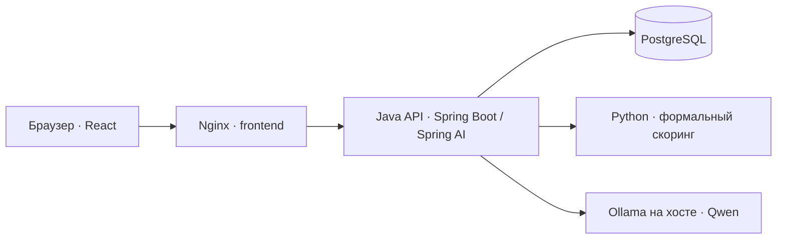

# Умный кредитный кабинет предпринимателя

Веб-приложение для выбора финансирования бизнеса, заполнения заявки и автоматического рассмотрения. Локальный ИИ-помощник объясняет условия продуктов и поля анкеты. Решение по заявке принимает отдельный расчётный контур: проверки Java и Python-сервис платёжеспособности.

Проект предназначен для демонстрации на хакатоне. Компании, кредитные истории и условия продуктов демонстрационные. Приложение не подключено к банковским системам и не выполняет выдачу денег.

## Возможности

- **Пять продуктов с разной механикой.** Разовый кредит, овердрафт, возобновляемая линия, долгосрочное финансирование и линия на исполнение госконтракта. Форма, финансовый период, ограничения и описание погашения зависят от продукта.
- **Черновики и восстановление работы.** Заявки сохраняются в PostgreSQL; кабинет показывает недавние заявки и их состояние. Версия записи защищает от перезаписи изменений из другой вкладки.
- **Автоматическое рассмотрение в фоне.** После отправки интерфейс получает подтверждение принятия, затем показывает одобрение, отказ, запрос уточнения или техническую остановку.
- **Осмысленное уточнение данных.** Нулевые поступления отличаются от незаполненного поля. Для допустимой заявки с нулём система может запросить подтверждение или исправление значения.
- **Повторы без дублирования.** Идемпотентность защищает создание заявок, отправку на рассмотрение и сообщения чата при повторном сетевом запросе.
- **Локальный помощник через Spring AI.** Qwen получает каталог и разрешённый контекст заявки, объясняет поля и предлагает продукт. История диалога сохраняется. Помощник не меняет анкету и не принимает кредитное решение.
- **Согласованные данные.** Интерфейс, проверки и контекст помощника используют условия серверного каталога. Рассмотрение сохраняет снимки данных, условий и версии алгоритма.
- **Контейнеры и нативная модель.** Четыре сервиса поднимаются из одного Compose. Помощник подключается к Ollama на компьютере через Spring AI; запуск кабинета не ждёт модель. БД хранится в Docker-томе, веса — в нативном хранилище Ollama.

## Быстрый запуск

Нужны установленный и запущенный Docker с Compose V2 и доступ к интернету для первой сборки. На Windows используется Docker Desktop в режиме Linux-контейнеров. Java, Node.js и Python на хосте не требуются; обязательного `.env` нет.

Для ИИ-помощника отдельно устанавливается нативная Ollama (проверена версия **0.40.11**) и загружается `qwen3.5:9b-q4_K_M`. API Ollama должен быть доступен из Docker на порту 11434. Пошаговая установка для Windows/macOS/Linux — в [инструкции подключения модели](docker/README.md#2-установка-и-запуск-ollama). Помощник включён по умолчанию; если сервер модели недоступен, чат показывает ошибку, а кабинет и рассмотрение продолжают работать.

Из корня репозитория:

**Windows, PowerShell**

```powershell
.\docker\up.ps1
```

**Linux и macOS, Bash**

```bash
bash docker/up.sh
```

Запускатор собирает образы Java, React и Python, поднимает четыре сервиса с готовым PostgreSQL и ожидает их готовности. Затем выполняется короткая проверка доступности API нативной Ollama из Java-контейнера. Веса модели автоматически не скачиваются. Запускатор не запускает Ollama: нативное приложение или `ollama serve` должны быть запущены отдельно. Автоматического прогрева нет; первый вопрос загружает веса, после запроса они удерживаются до 10 минут простоя.

После запуска:

1. Открыть [http://localhost:8080](http://localhost:8080).
2. В шапке переключить **«Моки OpenAPI» → «Java API (/api/v1)»**. При первом открытии браузер по умолчанию использует моки.
3. Выбрать продукт, заполнить анкету и отправить заявку.
4. Дождаться результата проверки. Для вопросов об условиях и полях открыть помощника.

| Адрес | Назначение |
|---|---|
| [localhost:8080](http://localhost:8080) | Интерфейс приложения |
| [localhost:8080/swagger-ui/index.html](http://localhost:8080/swagger-ui/index.html) | Swagger UI серверного API |
| [localhost:8080/v3/api-docs](http://localhost:8080/v3/api-docs) | OpenAPI, сформированный Java |
| [localhost:8080/actuator/health](http://localhost:8080/actuator/health) | Проверка здоровья Java |

Для остановки и повторного запуска с сохранением контейнеров:

```bash
docker compose stop postgres scoring backend frontend
docker compose start postgres scoring backend frontend
```

Нативная Ollama запускается и останавливается отдельно средствами ОС. Подробная инструкция: [Docker: запуск, оборудование, данные и устранение ошибок](docker/README.md).

### Два режима интерфейса

| Режим | Поведение |
|---|---|
| Моки OpenAPI | Данные и ответы имитируются в браузере. Подходит для просмотра интерфейса без серверов. Реплики помощника шаблонные. |
| Java API | Настоящие HTTP-запросы в Java, PostgreSQL, Python-скоринг и локальную Qwen через Ollama. Вход выполняется в подготовленный демоаккаунт. |

Демонстрационные данные в Java API не означают использование моков: реальные компоненты приложения выполняют полный сценарий, но работают с синтетическими сведениями.

## Каталог финансирования

Все суммы — в рублях, ставки — годовые демонстрационные условия.

| Продукт | Сумма или лимит | Срок | Ставка | Особенности |
|---|---|---|---|---|
| Оборотный кредит | 100 тыс. — 3 млн | 3–12 месяцев | 24% | Разовая выдача, аннуитет; финансовые показатели за 6 месяцев |
| Овердрафт | 50 тыс. — 1 млн | Лимит на 12 месяцев | 26% | Не более 30% среднемесячных поступлений за 3 месяца; задолженность закрывается за 30 дней |
| Возобновляемая кредитная линия | 300 тыс. — 5 млн | Линия на 24 месяца | 23% | Транши на 3–6 месяцев; возвращённый основной долг восстанавливает лимит |
| Кредит на длительный срок | 500 тыс. — 5 млн | 24–60 месяцев | 22% | Разовая выдача, аннуитет; нужны цель и бюджет проекта, показатели за 12 месяцев |
| Кредитная линия на исполнение госконтракта | 300 тыс. — 10 млн | 1–12 месяцев | 21% | Заключённый контракт по 44-ФЗ; предел 70% от стоимости за вычетом аванса; лимит не возобновляется |

Овердрафт требует расчётного счёта и регулярных поступлений. Минимальный возраст бизнеса — 6 месяцев для оборотного кредита и овердрафта, 12 месяцев для остальных продуктов.

Приложение различает срок линии, срок транша и срок задолженности. Аннуитетный расчёт в интерфейсе используется для продуктов с аннуитетным погашением. Подробности и формулы: [кредитная политика](docs/CREDIT_POLICY_AND_ML_REQUIREMENTS.md).

## Как проходит заявка

### 1. Вход и выбор продукта

При включении Java API интерфейс получает CSRF-токен, создаёт демосессию, обновляет токен после входа и загружает профиль компании. Пароль не требуется. Список продуктов поступает из серверного каталога.

### 2. Создание и заполнение

Выбор продукта создаёт черновик. Сервер закрепляет продукт, расчётную дату и период финансовых показателей: 3, 6 или 12 полных месяцев. Форма сохраняется с проверкой версии.

Общие поля — сумма, срок, среднемесячные поступления и расходы, свободные собственные средства до получения кредита. Для отдельных продуктов добавляются цель и бюджет, срок транша или сведения о госконтракте. Неизвестное значение остаётся пустым; настоящий ноль хранится как ноль.

### 3. Отправка

Java проверяет доступ, состояние, версии, полноту формы, диапазоны сумм и сроков, применимые поля и даты. Некорректная форма возвращается с ошибками полей и не попадает в скоринг.

Успешная отправка одной транзакцией сохраняет снимок данных, условий и политики, создаёт попытку рассмотрения и переводит заявку в `CHECKING`. Ответ `202 Accepted` означает принятие на обработку.

### 4. Рассмотрение

Фоновый обработчик последовательно:

1. Проверяет возраст бизнеса и требования продукта к счёту и поступлениям.
2. Получает демонстрационный кредитный отчёт и сохраняет его в попытке.
3. Проверяет текущую просрочку.
4. При необходимости запрашивает подтверждение нулевых поступлений.
5. Передаёт согласованные признаки в Python.
6. Проверяет ответ скоринга и сохраняет решение, причины и условия.

Внешние вызовы выполняются вне транзакций БД. Токен и срок захвата попытки не позволяют запоздавшему обработчику записать устаревший результат.

### 5. Результат

| Статус | Значение |
|---|---|
| `DRAFT` | Редактируемый черновик |
| `CHECKING` | Заявка принята и рассматривается |
| `NEEDS_INFO` | Требуется подтвердить или исправить запрошенное значение |
| `TECHNICAL_HOLD` | Проверка не завершена из-за технического сбоя; доступен повтор |
| `APPROVED` | Демонстрационные условия одобрены |
| `DECLINED` | Получен отказ с причиной |

Технический сбой не превращается в кредитный отказ. Повтор после `TECHNICAL_HOLD` создаёт новую попытку с прежними исходными данными; продолжение после уточнения учитывает сохранённое исправление или подтверждение. История попыток сохраняется.

## Скоринг и ИИ-помощник

### Python: формальная проверка платёжеспособности

Скоринг моделирует остаток собственных денег с учётом поступлений, расходов, нового платежа и резерва ликвидности. Он использует стресс поступлений 10%, коэффициент нового платежа 1,30 и резерв в один месяц расходов. Платёжная механика зависит от продукта.

Текущий алгоритм детерминированный, без обученных весов. `riskScore` принимает 0 или 1 и не является вероятностью дефолта. Java дополнительно применяет обязательные бизнес-проверки и контролирует версию алгоритма.

Подробнее: [скоринг](docs/SCORING.md).

### Qwen: помощь при выборе и заполнении

Java вызывает Ollama через **Spring AI**, используя локальную `qwen3.5:9b-q4_K_M`. Помощник получает каталог, определения полей, ограниченную историю и разрешённые данные выбранной заявки. Полный кредитный отчёт и номер госконтракта в модель не передаются.

Ответ имеет строгую JSON-структуру. Java проверяет рекомендованный продукт и применяет правила для числовых условий из каталога. Успешные вопрос и ответ сохраняются вместе; при ошибке неполная пара не появляется в истории.

Помощник не запускает рассмотрение, не исправляет форму и не обещает одобрение. Выбор предложенного продукта выполняется отдельным действием в интерфейсе.

Подробнее: [устройство помощника](docs/ASSISTANT.md).

## Архитектура и технологии



| Компонент | Технологии | Ответственность |
|---|---|---|
| Интерфейс | React 18, Vite, Tailwind CSS | Каталог, форма, статусы, диалог |
| API и обработчик | Java 21, Spring Boot, Spring Security, Spring Data JPA, JDBC | Доступ, заявки, политика, фоновые попытки, сохранение |
| Данные | PostgreSQL 18, Flyway, JSONB | Текущие записи, снимки, история, повторы |
| Скоринг | Python 3.12, Decimal, JSON Schema | Расчёт платёжеспособности |
| Помощник | Spring AI, Ollama, Qwen 3.5 9B Q4_K_M | Генерация объяснений и рекомендаций |
| Контейнеры | Docker Compose, Nginx | Общий запуск и маршрутизация |

Четыре контейнера работают в общей сети Compose. Наружу опубликованы интерфейс на `127.0.0.1:8080` и PostgreSQL на `127.0.0.1:5432`. Java и скоринг используют внутренние адреса; Ollama доступна Java по `http://host.docker.internal:11434`.

## Что сохраняется

В PostgreSQL находятся компании, пользователи, продукты, заявки, попытки, уточнения, события, результаты идемпотентных команд и сообщения помощника. Снимки рассмотрения и технические метаданные хранятся в JSONB. Всего 10 прикладных таблиц и служебная таблица истории Flyway.

База использует постоянный Docker-том, веса модели — нативное хранилище Ollama. Перезапуск Java сбрасывает сессии в памяти, но сохраняет заявки и диалоги; демовход восстанавливается при следующем открытии кабинета.

Денежные значения передаются API строками с двумя знаками после точки, например `"100000.00"`, и обрабатываются через `BigDecimal` / `Decimal`.

## Оборудование и ограничения

- Нативная Ollama использует доступное ускорение: Metal на Mac M-серии, поддерживаемые GPU на Windows/Linux либо CPU. Наличие встроенной графики не гарантирует ускорение.
- Модель и её контекст требуют несколько гигабайт памяти. Перенос из Docker не уменьшает размер Qwen; быстрые ответы на каждом ПК с 8–16 ГБ без GPU не подтверждены.
- Основной кредитный путь не требует GPU и не запускает модель автоматически. Подтверждение работы при 8 ГБ RAM требует отдельного измерения.
- Бюджет помощника — 60 секунд. Ранее полный CPU-запрос превышал его; эти измерения относятся к прежнему контейнерному запуску. Один полный вопрос на Windows с RTX 4060 через нативную Ollama занял 15,13 секунды и вернул верную ставку 24%; это не измерение офисного ПК без GPU.
- Первая сборка и загрузка модели требуют интернета. Интерфейс использует внешние ресурсы Tailwind CSS и Google Fonts; автономный режим без сети не предусмотрен.
- Реальные БКИ, выписки, проверка реестров, подписание договора и выдача кредита не подключены. Локальная БД без пароля настроена для демонстрационных данных.

## Структура репозитория

```text
backend/         Java API, политика, обработчик, Spring AI, миграции
frontend/        React-интерфейс и API-клиент
ml/scoring/      Python-сервис формальной проверки
ml/llm/          Python-стенд разработки и материалы помощника
docs/            Техническая документация и контракты
docker/          Dockerfile, Nginx, запускаторы и инструкция
compose.yaml     Общая конфигурация пяти сервисов
README.md        Обзор проекта и быстрый старт
```

Python-стенд `ml/llm` не является отдельным сервисом приложения: в общем запуске Java обращается непосредственно к Ollama.

## Документация

- [Подробный запуск и контейнеризация](docker/README.md) — оборудование, сборка, сеть, тома, команды и диагностика.
- [Навигация по технической документации](docs/README.md).
- [Архитектура и разработка](docs/BACKEND_ARCHITECTURE.md) — границы компонентов и запуск из IDE.
- [Путь запроса по Java-коду](docs/BACKEND_WALKTHROUGH.md) — классы, транзакции, повторы и соединения.
- [Сценарии демонстрации](docs/BACKEND_SCENARIOS.md) — ожидаемые исходы и примеры данных.
- [Контракты API](docs/contracts/README.md) — маршруты, версии и форматы.
- [Схема данных](docs/DATABASE_SCHEMA.md), [кредитная история](docs/CREDIT_HISTORY.md), [правила рассмотрения](docs/CREDIT_POLICY_AND_ML_REQUIREMENTS.md).
- [Фронтенд](docs/FRONTEND.md), [скоринг](docs/SCORING.md), [помощник](docs/ASSISTANT.md).
