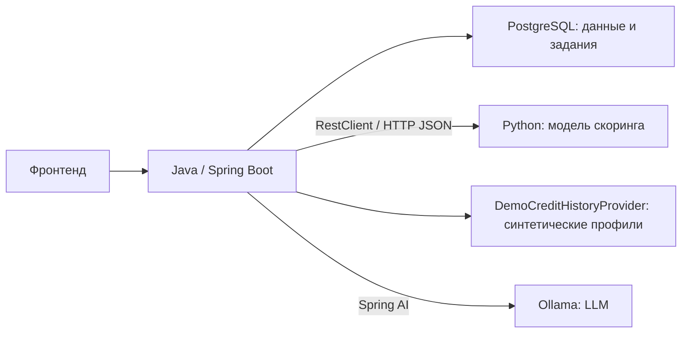

# Бэкенд: архитектура и стек

Принятые решения для MVP, обновлено 24.10.2026. Документ описывает целевую реализацию.

[Сценарии и правила](BACKEND_SCENARIOS.md)

## 1. Состав решения

- Пять продуктов: оборотный кредит, овердрафт, возобновляемая линия, кредит на длительный срок и линия на госконтракт. Один общий процесс заявки, типизированные формы и продуктовые ограничения.
- Один Java-бэкенд, один Maven-проект, один JAR и одна PostgreSQL.
- Веб-кабинет обращается только к Java API.
- Python-сервис скоринга возвращает оценку риска. Java принимает кредитное решение по правилам.
- Java получает синтетическую кредитную историю компании через локальный `CreditHistoryProvider` и сохраняет отчёт перед скорингом. Реальное подключение к БКИ не входит в MVP.
- LLM-помощник работает через Spring AI и Ollama.
- Рассмотрение заявки выполняется в фоне. Задания хранятся в PostgreSQL.
- Все данные и кредитные условия демонстрационные. Реальную выдачу денег не выполняем.



## 2. Стек

| Задача | Инструмент |
|---|---|
| Язык | Java 21 LTS |
| Приложение и REST API | Spring Boot 4.1.2, Spring MVC |
| Сборка | Maven 3.9.16, Maven Wrapper |
| База данных | PostgreSQL 18 |
| Доступ к данным | Spring Data JPA, Hibernate |
| Миграции | Flyway, SQL-миграции; Hibernate `ddl-auto=validate` |
| Валидация DTO | Jakarta Bean Validation |
| Пользователь и сессия | Spring Security, HTTP-сессия, cookie |
| LLM | Spring AI 2.0.2, Ollama |
| HTTP-клиент скоринга | Spring `RestClient` |
| Документация API | springdoc-openapi 3.1.1, Swagger UI |
| Ошибки API | `ProblemDetail`, коды ошибок, ошибки полей |
| Диагностика | SLF4J, Logback, Actuator |
| Тестирование | JUnit Jupiter, AssertJ, Mockito, Testcontainers с PostgreSQL |
| Общий запуск | Docker, Docker Compose |
| CI | GitHub Actions: сборка и тесты |

Версии закреплены в [pom.xml](../backend/pom.xml). Hibernate, JUnit и Testcontainers управляются Spring Boot; Spring AI — отдельным BOM.

### По необходимости

| Инструмент | Когда добавляем |
|---|---|
| `JdbcClient` | Сложные SQL-выборки рядом с JPA; первоначально для чтения |
| Caffeine / Spring Cache | Есть измеримая польза от кэширования справочников |
| Resilience4j | Нужны circuit breaker или ограничение параллельных вызовов моделей |
| MapStruct | Ручное преобразование DTO становится объёмным |
| ArchUnit | Для автоматической проверки границ пакетов |

Kafka, Redis и gRPC в стартовый стек не входят. Пересматриваем решение при появлении независимых потребителей событий, нескольких экземпляров бэкенда или обоснованных требований к обмену с ML.

## 3. Области кода

| Пакет | Ответственность |
|---|---|
| `identity` | Демопользователь, компания, создание сессии, текущий пользователь |
| `catalog` | Продукты, описания, ограничения и версии условий |
| `credit` | Черновики, рассмотрение, состояния, кредитный профиль, скоринг, решения и история |
| `assistant` | Вопросы пользователя, контекст, инструкции и интеграция с LLM |
| `config` | Настройки Spring, Security, HTTP-клиентов и обработчика заданий |
| `common.error` | Общая обработка ошибок API |

Пример структуры относительно корневого Java-пакета:

```text
creditcabinet/
├── CreditCabinetApplication.java
├── identity/
├── catalog/
├── credit/
│   ├── api/              # Контроллеры, HTTP DTO
│   ├── service/          # Сценарии и транзакции
│   ├── model/            # Заявка, состояния, попытки рассмотрения
│   ├── decision/         # Правила решения и расчёты
│   ├── persistence/      # JPA-репозитории, целевые выборки
│   ├── scoring/          # Контракт скоринга и HTTP-реализация
│   ├── credithistory/    # CreditHistoryProvider, отчёт, демореализация
│   └── processing/       # Фоновая обработка и восстановление заданий
├── assistant/
│   ├── api/
│   ├── service/
│   └── integration/      # AssistantGateway и реализация через Spring AI
├── config/
└── common/
    └── error/
```

Продуктовые условия и правила расчёта лимитов находятся в [кредитной политике](CREDIT_POLICY_AND_ML_REQUIREMENTS.md). Форма использует цель/бюджет LONG_TERM, срок транша REVOLVING_LINE и сведения о госконтракте; EQUIPMENT больше не используется. Период финансов 3/6/12 месяцев и calculationDate фиксируются при создании. Обслуживание траншей и реальные платежи не входят в MVP.

Корневой Java-пакет и Maven groupId — `com.creditcabinet`. Стартовая структура создана в [backend/src/main/java/com/creditcabinet/](../backend/src/main/java/com/creditcabinet/). Назначение подпакетов закреплено в `package-info.java`; бизнес-классы добавляются при реализации сценариев. Отдельные Maven-модули не создаются. Миграции находятся в `backend/src/main/resources/db/migration/`.

На этапе каркаса добавлены только стартовый класс, структура пакетов, Maven Wrapper и зависимости. `application.yaml` содержит имя приложения. Описанные ниже настройки, классы, миграции и тесты относятся к дальнейшей реализации.

## 4. Правила разработки

| Часть | Обязанность |
|---|---|
| Controller | Принять запрос, проверить DTO, получить пользователя, вызвать сервис |
| Service | Организовать сценарий: доступ, загрузка, проверки, интеграции, сохранение |
| Model | Хранить состояние и защищать допустимые изменения заявки |
| Decision policy | Применять правила и формировать решение с кодами причин |
| Repository | Читать и сохранять данные |
| Integration client | Вызывать модель и преобразовывать её ответ и ошибки |

- HTTP DTO отделены от JPA-сущностей. DTO преимущественно оформляем как `record`.
- JPA-аннотации на бизнес-сущности допустимы; отдельную копию модели для сохранения не вводим.
- Денежные расчёты выполняем через `BigDecimal`. Формат денег в API закрепим в OpenAPI.
- Правила решения проверяются без HTTP, LLM и запуска Spring.
- Интерфейсы вводим на изменяемых границах: `CurrentUserProvider`, `CreditHistoryProvider`, `RiskScoringClient`, `AssistantGateway`.
- Пары `Service` / `ServiceImpl` для каждого класса не создаём.
- Используем внедрение зависимостей через конструктор.
- Новые ограничения продукта описываем данными. Отдельную стратегию добавляем при появлении другой механики расчёта или выдачи.

### Зависимости

- `credit` получает условия через сервис `catalog`.
- `assistant` читает каталог через `catalog`, контекст заявки — через сервис чтения `credit` с проверкой доступа.
- `credit` не зависит от работоспособности помощника.
- Область не обращается к чужому репозиторию и не изменяет чужую сущность.
- Между областями передаём идентификаторы и неизменяемые объекты, например `ProductTerms`.
- Циклические зависимости запрещены. В `common` не складываем кредитные правила и универсальные бизнес-сервисы.

## 5. Демовход и доступ

1. При открытии кабинета фронт автоматически инициирует демосессию. Экрана входа нет.
2. Сервер выбирает заранее подготовленного пользователя и компанию; сохраняет пользовательский контекст в HTTP-сессии.
3. Браузер получает cookie с идентификатором сессии и отправляет её в следующих запросах.
4. Spring Security восстанавливает контекст, `CurrentUserProvider` предоставляет его сервисам.
5. Сервис заявки проверяет доступ по текущей компании и её представителю.

Регистрации, ввода пароля, JWT и refresh-токенов нет. Автовход включён только в деморежиме и имитирует уже выполненную проверку личности.

Создание демосессии — отдельная начальная операция. Защищённый запрос без сессии возвращает ошибку, а не автоматически получает тестового пользователя. `userId` и `companyId` из тела запроса не подтверждают права.

Сессии первоначально храним в памяти одного экземпляра приложения. После перезапуска демосессия создаётся повторно; данные заявок остаются в PostgreSQL. Разные браузеры имеют разные сессии, но при одном демоаккаунте работают с одними данными.

Для изменяющих запросов учитываем CSRF; cookie настраиваем с `HttpOnly` и подходящими параметрами окружения. Cookie, CSRF и поведение при истечении сессии описываем в контракте фронтенда.

## 6. Скоринг и LLM

| Компонент | Работа | Результат |
|---|---|---|
| Python-сервис скоринга | Оценить согласованные признаки | Оценка, версия модели, предусмотренные контрактом сведения |
| Java `CreditHistoryProvider` | Получить синтетический профиль компании | Успешный кредитный отчёт либо техническая ошибка |
| Java `CreditDecisionPolicy` | Применить условия продукта и правила | Решение и реальные причины |
| Ollama / LLM | Объяснить продукт, поле, помочь с выбором | Текстовая подсказка |

`RiskScoringClient` возвращает наш `RiskAssessment`. `HttpRiskScoringClient` проверяет внешний ответ и переводит ошибки транспорта. Шкалу, направление оценки и признаки закрепляем в ML-контракте. Технический сбой не заменяем числовым риском.

`DemoCreditHistoryProvider` работает внутри Java с подготовленными синтетическими профилями. Пользователь не вводит кредитную историю; Python не получает её самостоятельно. Успешный отчёт фиксируется однократно в `credit_assessment.credit_history_snapshot` до вызова ML. `AVAILABLE` и `NO_HISTORY` входят в схему признаков `3`; недоступность источника приводит к `TECHNICAL_HOLD`. Внутренний контракт, показатели и повторы определены в [кредитном профиле](CREDIT_HISTORY.md). Отдельный HTTP-сервис или реальная интеграция с БКИ для MVP не создаются.

`AssistantGateway` скрывает Spring AI и Ollama от остальных областей. Java формирует разрешённый контекст, ML-команда готовит модель, инструкции, примеры и запуск. Условия продуктов и определения полей для LLM берём из согласованных данных приложения.

В MVP помощник объясняет поля и продукты, рекомендует один из доступных продуктов. Анкету не изменяет, заявку не отправляет и одобрение не обещает. Дополнительный Python-сервис для пересылки запросов в Ollama не нужен.

## 7. Фоновое рассмотрение

1. `SubmitApplicationService` проверяет доступ, версию, данные и допустимость отправки.
2. В одной транзакции сохраняет снимок данных и условий, попытку рассмотрения, `CHECKING` и задание.
3. Обработчик внутри приложения забирает задание и вызывает `ProcessApplicationService`.
4. После обязательных правил Java (возраст, счёт/регулярность для овердрафта) обработчик получает кредитный отчёт вне транзакции и сохраняет его однократно под действующим захватом.
5. По отчёту проверяет отсутствие текущей просрочки: иначе DECLINED/CURRENT_OVERDUE_DEBT без ML. Затем проверяет необходимость подтверждения нулевых поступлений. Только после этого собирает признаки схемы 3 из обоих снимков и вызывает скоринг вне транзакции; внешние операции имеют конечные бюджеты.
6. Java применяет политику. В короткой транзакции сохраняет оценку, решение, причины, историю и завершение задания.
7. Перед сохранением отчёта и результата проверяет актуальность попытки, токен и срок захвата. Поздний ответ старого обработчика не меняет заявку.
8. Фронт периодически запрашивает состояние до результата или технического сбоя.

При восстановлении обработки и техническом `retry` уже сохранённый кредитный отчёт используется повторно. Если его ещё не удалось получить, выполняется получение. Сбой источника не подменяется отсутствием истории и не запускает ML.

Задания хранятся в PostgreSQL. Получение задания защищено от одновременного захвата; зависшая работа обнаруживается и восстанавливается. Одной очереди в памяти или `@Async` для этого не используем.

Повтор HTTP-вызова после сбоя может повторно запустить вычисление модели. Однократное применение результата обеспечиваем у себя: активной попыткой, проверкой версии и атомарным сохранением. Бесконечных повторов нет.

## 8. Данные, диагностика и проверки

- Оптимистическая блокировка защищает от потери изменений между вкладками.
- Повтор одной команды отправки не создаёт независимую проверку.
- Сохраняем рассмотренные данные, условия продукта, оценку, версии модели и правил, результат и историю переходов.
- В `NEEDS_INFO` сохраняем вопрос с идентификатором, исходным значением и периодом, ответ пользователя и связь с новой попыткой. Подтверждение неизменного значения переносится при техническом повторе; циклический запрос того же уточнения исключён.
- Обновление каталога или страницы не пересчитывает готовое решение.
- В выборках используем DTO-проекции и целевую загрузку связей; контролируем N+1. Списки ограничиваем и разбиваем на страницы.
- JDBC-обновления не смешиваем бесконтрольно с уже загруженными JPA-сущностями.
- В логах есть идентификаторы запроса, заявки и попытки. Полную анкету, переписку, секреты и сессию в обычные логи не пишем.
- Проверяем правила на границах, доступ к чужой заявке, повторы, конкуренцию, сбои моделей и восстановление после перезапуска.

Форматы API определены в [контрактах](contracts/README.md), правила решения и уточнений — в [кредитной политике](CREDIT_POLICY_AND_ML_REQUIREMENTS.md), таблицы и транзакции — в [схеме БД](DATABASE_SCHEMA.md). В упрощённой схеме текущие условия находятся в продукте, исторические — в снимке попытки; сама попытка хранит сведения о её фоновой обработке. Отдельные таблицы условий и заданий не создаются.
