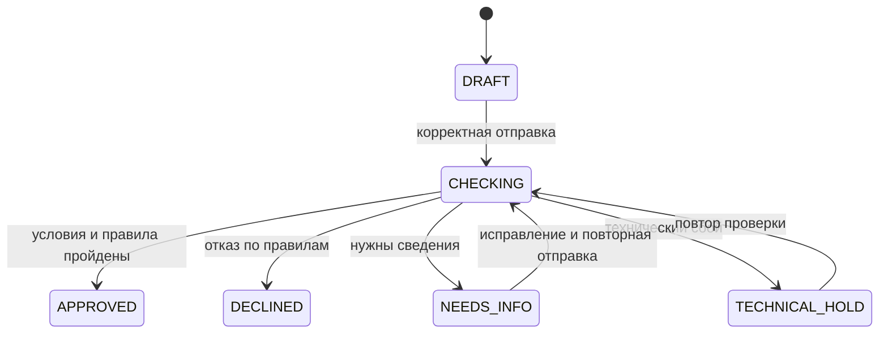

# Бэкенд: сценарии и принятые решения

Принятые решения для MVP, 22.10.2026.

[Архитектура и стек](BACKEND_ARCHITECTURE.md)

## 1. Границы MVP

| Область | Решение |
|---|---|
| Продукты | Оборотный кредит и кредит на оборудование; сохраняем возможность расширения |
| Интерфейс | Каталог и страница заявки с помощником, состоянием и результатом |
| Пользователь | Представитель подготовленной демокомпании; автоматическая HTTP-сессия |
| Рассмотрение | Полностью автоматическое, в фоне, через задания PostgreSQL |
| ИИ | LLM-помощник и отдельная модель скоринга |
| Решение | Java применяет условия продукта и правила к данным и оценке риска |
| Помощник | Объясняет поля и продукты, помогает выбрать; не меняет и не отправляет заявку |
| Не входит | Регистрация, JWT, кабинет сотрудника банка, ручное рассмотрение, реальная выдача, автоматические альтернативные предложения |

### Данные формы

Общие поля: продукт, сумма, срок, среднемесячные поступления и среднемесячные расходы. Пользователь и компания определяются по сессии. Дополнительные сведения задаются условиями продукта и согласованными признаками скоринга.

У каждого продукта есть описание назначения, допустимые суммы и сроки, ставка, требования к бизнесу и необходимые поля. Конкретные значения и определения финансовых показателей фиксируем при подготовке контрактов; числа из прежних версий документов автоматически не переносим.

## 2. Состояния и доступные действия

| Состояние | Смысл | Действия пользователя |
|---|---|---|
| `DRAFT` | Сохранённый, в том числе неполный, черновик | Читать, редактировать, отправить |
| `CHECKING` | Выполняется рассмотрение | Читать состояние; данные не редактировать |
| `NEEDS_INFO` | Нужны конкретные уточнения | Читать, исправить запрошенные сведения, отправить повторно |
| `TECHNICAL_HOLD` | Рассмотрение прервано техническим сбоем | Читать, повторить проверку по сохранённым данным |
| `APPROVED` | Сохранено одобрение | Читать решение и условия |
| `DECLINED` | Сохранён отказ по правилам | Читать решение и причины |

Ошибки формы до рассмотрения оставляют заявку в `DRAFT`. Сохранение уточнений оставляет её в `NEEDS_INFO` до повторной отправки. Готовое решение не редактируется. Изменение продукта существующей заявки и новая подача после решения не входят в перечисленные ниже операции первой версии.

## 3. Сценарии

### S01. Открыть кабинет

1. Фронт автоматически инициирует демосессию, бэк задаёт тестового пользователя и компанию.
2. Браузер получает cookie, фронт читает текущего пользователя и каталог.

**Результат:** пользователь работает в кабинете без экрана входа. Повторная инициализация действующей сессии не меняет аккаунт.

### S02. Выбрать продукт

1. Пользователь изучает карточку и выбирает один из двух продуктов.
2. Фронт открывает форму; бэк проверяет выбранный продукт по своему каталогу.

**Результат:** выбранный продукт связан с новым черновиком. Ставка и ограничения берутся на сервере, а не из присланных браузером условий.

### S03. Сохранить черновик

1. Бэк создаёт `DRAFT` для текущего пользователя и компании.
2. При сохранении проверяет доступ, версию заявки и допустимость значений.
3. Сохраняет данные и возвращает актуальную версию.

**Результат:** сохранённая часть анкеты восстанавливается после обновления страницы. Полнота для отправки пока не требуется. Отклонённый запрос не затирает ранее сохранённые данные.

### S04. Отправить заявку

1. Бэк проверяет доступ, состояние, версию и повтор команды.
2. Проверяет полноту, формат и согласованность данных.
3. При ошибках возвращает поля и объяснения; скоринг не запускается.
4. При пригодных данных атомарно сохраняет снимок данных и условий, попытку, `CHECKING` и задание.
5. Фронт показывает проверку и запрашивает актуальное состояние.

**Результат:** одна активная попытка рассмотрения. Данные во время проверки не изменяются. Повтор отправки той же команды не создаёт вторую независимую проверку.

### S05. Одобрить

1. Обработчик получает сохранённые данные и вызывает Python-сервис скоринга.
2. Проверяет ответ и применяет условия продукта и правила Java.
3. Если все обязательные критерии пройдены, сохраняет `APPROVED`, оценку, условия, версии и историю.

**Результат:** фронт показывает сохранённое одобрение, сумму, срок и условия. Обновление страницы не запускает новый расчёт.

### S06. Отказать

1. На пригодных для рассмотрения данных срабатывает согласованное правило отказа.
2. Бэк сохраняет `DECLINED`, код и понятное объяснение реальной причины, данные и версии.

**Результат:** фронт показывает отказ. Основание не придумывается LLM. Если отказ возможен до скоринга по конкретному правилу, отсутствующая оценка не подменяется фиктивным значением.

### S07. Запросить уточнение

1. Проверка выявляет конкретные сведения, необходимые для продолжения.
2. Бэк сохраняет `NEEDS_INFO`, поля и объяснения.
3. Пользователь исправляет сведения, сохраняет и отправляет их повторно по S04.

**Результат:** новая попытка рассматривает обновлённые данные; предыдущие сведения и история не теряются. Высокий риск не является просьбой искусственно изменить финансовые показатели.

### S08. Обработать технический сбой и повторить

1. Модель недоступна, истёк таймаут, ответ нарушает контракт либо обработка не может завершиться.
2. Бэк сохраняет `TECHNICAL_HOLD`, сведения о попытке и причине сбоя.
3. Пользователь запускает повтор; бэк проверяет доступ и отсутствие другой активной проверки.
4. В одной транзакции создаёт новую попытку и задание, возвращает `CHECKING`.

**Результат:** повторяется рассмотрение существующей заявки по сохранённым данным. Новая заявка не создаётся. При техническом сбое кредитного отказа нет.

### S09. Восстановить кабинет

1. После обновления страницы фронт читает сохранённую заявку и её состояние.
2. Если сессия исчезла, автоматически создаёт демосессию того же аккаунта и повторно читает данные.
3. После перезапуска бэкенда обработчик восстанавливает незавершённые задания; невосстановимая попытка получает `TECHNICAL_HOLD` с возможностью повтора.

**Результат:** сохранённые данные и готовое решение доступны. Заявка не остаётся навсегда в `CHECKING` без обработки. Ввод, который браузер ещё не отправил, сервер восстановить не может.

### S10. Получить помощь LLM

1. Пользователь задаёт вопрос о продукте или поле, в том числе до создания заявки.
2. Бэк собирает актуальный каталог и определения полей. При использовании заявки проверяет доступ и добавляет необходимый контекст.
3. Через `AssistantGateway`, Spring AI и Ollama получает и возвращает подсказку.

**Результат:** объяснение, рекомендация доступного продукта или уточняющий вопрос. Помощник не сохраняет поля, не отправляет заявку и не обещает одобрение.

При недоступности LLM форма и рассмотрение продолжают работать. Пользователь получает понятное сообщение; подготовленную справку показываем только при её наличии.

## 4. Таблица исходов

| Ситуация | Поведение |
|---|---|
| Пустое обязательное поле, неверный формат, исправимое противоречие до отправки | Ошибки конкретных полей; без кредитного отказа и вызова скоринга |
| После запуска нужны согласованные дополнительные сведения | `NEEDS_INFO`, поля и причины уточнения |
| Все обязательные условия выполнены и риск допустим | `APPROVED` |
| Сработало правило отказа или риск недопустим | `DECLINED` с реальной причиной |
| Ошибка модели, таймаут, некорректный ответ | `TECHNICAL_HOLD`, данные сохранены, доступен повтор |
| Недоступен только помощник | Ошибка помощника; форма и независимая проверка доступны |

Низкий риск не отменяет продуктовые ограничения. Конкретный набор правил, числовые границы и случаи уточнения задаются таблицей кредитной политики; непроверенные данные не объявляются проверенными.

## 5. Тонкости реализации и приёмки

| Ситуация | Требование |
|---|---|
| Двойной клик или повтор после потери ответа | Команда распознаётся как повтор; независимое рассмотрение не дублируется |
| Две вкладки меняют одну заявку | Проверяется версия; новые данные не перезаписываются устаревшими |
| Старый ответ ML пришёл после новой попытки | Не применяется к актуальной заявке |
| Обновился каталог | Сохранённое решение и рассмотренные условия не меняются |
| Изменились условия до отправки | Бэк проверяет актуальные условия; влияющие на форму изменения сообщает фронту |
| Сессия истекла во время операции | После восстановления нельзя молча повторять изменение с неизвестным результатом; проверяем состояние или используем ту же идентичность команды |
| Браузер передал чужой идентификатор | Доступ проверяется на сервере, включая контекст для LLM |
| Два браузера под одним демоаккаунтом | Это один пользователь и доступный ему набор заявок, несмотря на разные cookie |
| Перезапуск во время HTTP-вызова модели | Возможен повтор вычисления, но результат применяется только к актуальной попытке и однократно |
| Неверная структура ответа скоринга | Техническая ошибка; не выдуманный риск и не новый обязательный вопрос формы |
| Оценка точно на пороге | Применяется явно заданное и проверенное тестом правило границы |

Для негативных тестов доступа используем вторую синтетическую компанию и пользователя. Регистрация или переключатель аккаунтов в UI для этого не нужны.

### Что сохраняем

- Данные черновика и текущую версию заявки.
- Снимок сведений и условий для каждого рассмотрения.
- Попытки, задания и сведения об ошибках.
- Оценку и версию модели, применённую версию правил.
- Решение, коды причин, условия и историю переходов.

Это логический набор данных, а не требование сделать отдельную таблицу для каждого пункта.

## 6. Ответственность команды

| Участник | Результат работы |
|---|---|
| Бэкенд | API, данные, сессия, доступ, задания, правила решения, интеграции, тесты |
| Фронтенд | Каталог, форма, сохранение, ошибки, состояния, опрос проверки, помощник |
| ML | LLM и инструкции, модель скоринга, Python HTTP API, примеры, зависимости и запуск |
| Аналитик / Product | Паспорта двух продуктов, определения полей, правила и причины решений |

ML-команда передаёт версии моделей, способ получения артефактов, требования к RAM/CPU/GPU, время ответа и рабочие примеры. До завершения UI проверяем сквозной вызов Java → скоринг и Java → Ollama на целевом компьютере.

## 7. Следующий этап: контракты

Готовим два OpenAPI-документа:

1. **Java API для фронта:** демосессия, текущий пользователь, каталог, черновики, сохранение, отправка, чтение состояния и решения, повтор проверки, помощник.
2. **Python API скоринга для Java:** входные признаки, оценка, идентификация запроса, версия модели и ошибки.

Ollama используем через существующий API. Для LLM отдельно фиксируем модель, инструкции, контекст и формат ответа помощника.

При подготовке контрактов задаём ещё не указанные значения и форматы:

- Суммы, сроки, ставки, дополнительные поля и ограничения двух продуктов.
- Смысл и период финансовых показателей, точную схему признаков скоринга.
- Шкалу, направление оценки, порог и поведение на границе; расчёты и причины решений, конкретные случаи `NEEDS_INFO`.
- Формат денег, дат, идентификаторов, версий и повторных команд.
- Cookie, CSRF, ошибки сессии, опрос состояния и таймауты моделей.
- Формат чата, сохранение истории и необходимость потоковой выдачи ответа.

Эти детали не меняют принятые границы MVP и архитектуру. Контракты сопровождаем синтетическими примерами одобрения, отказа, уточнения и технического сбоя.
