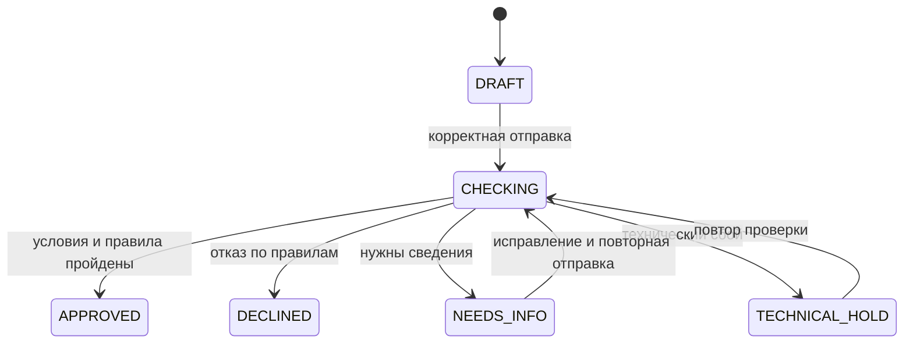

# Бэкенд: сценарии и принятые решения

Принятые решения для MVP, обновлено 24.10.2026.

[Архитектура и стек](BACKEND_ARCHITECTURE.md)

## 1. Границы MVP

| Область | Решение |
|---|---|
| Продукты | Оборотный, овердрафт, возобновляемая линия, длительный срок, линия на госконтракт |
| Интерфейс | Каталог и страница заявки с помощником, состоянием и результатом |
| Пользователь | Представитель подготовленной демокомпании; автоматическая HTTP-сессия |
| Рассмотрение | Полностью автоматическое, в фоне, через задания PostgreSQL |
| ИИ | LLM-помощник и отдельная модель скоринга |
| Кредитная история | Автоматический синтетический профиль компании через локальный `CreditHistoryProvider`; без реального БКИ |
| Решение | Java применяет условия продукта и правила к данным и оценке риска |
| Помощник | Объясняет поля и продукты, помогает выбрать; не меняет и не отправляет заявку |
| Не входит | Регистрация, JWT, кабинет сотрудника банка, ручное рассмотрение, реальная выдача, автоматические альтернативные предложения |

### Данные формы

Общие поля: продукт, сумма/лимит, срок кредита/линии, среднемесячные поступления и расходы. LONG_TERM требует цель и бюджет; REVOLVING_LINE — срок транша; GOVERNMENT_CONTRACT_LINE — сведения о заключённом контракте по 44-ФЗ. Неприменимые поля null. CalculationDate и период 3/6/12 месяцев задаёт сервер; пользователь и компания — по сессии.

Кредитную историю пользователь не вводит. Java получает её отдельно после обязательных правил и до проверки необходимости уточнения нулевых поступлений; исходные данные анкеты и полученный отчёт сохраняются раздельно. В API формы и контекст LLM показатели кредитного отчёта не добавляются.

У каждого продукта есть описание назначения, допустимые суммы и сроки, ставка, требования к бизнесу и необходимые поля. Конкретные значения, периоды, лимиты и механика уже закреплены в кредитной политике; прежние условия двух продуктов не переносятся.

## 2. Состояния и доступные действия

| Состояние | Смысл | Действия пользователя |
|---|---|---|
| `DRAFT` | Сохранённый, в том числе неполный, черновик | Читать, редактировать, отправить |
| `CHECKING` | Выполняется рассмотрение | Читать состояние; данные не редактировать |
| `NEEDS_INFO` | Нужно подтвердить либо исправить конкретные сведения | Читать, исправить запрошенные поля либо подтвердить значение, отправить ответ |
| `TECHNICAL_HOLD` | Рассмотрение прервано техническим сбоем | Читать, повторить проверку по сохранённым данным |
| `APPROVED` | Сохранено одобрение | Читать решение и условия |
| `DECLINED` | Сохранён отказ по правилам | Читать решение и причины |

Ошибки формы до рассмотрения оставляют заявку в `DRAFT`. Сохранение уточнений оставляет её в `NEEDS_INFO` до повторной отправки. Готовое решение не редактируется. Изменение продукта существующей заявки и новая подача после решения не входят в перечисленные ниже операции первой версии.

## 3. Сценарии

### S01. Открыть кабинет

1. Фронт автоматически инициирует демосессию, бэк задаёт тестового пользователя и компанию.
2. Браузер получает cookie, фронт читает текущего пользователя и каталог.

**Результат:** пользователь работает в кабинете без экрана входа. Повторная инициализация действующей сессии не меняет аккаунт.

### S02. Выбрать продукт

1. Пользователь изучает карточку и выбирает один из пяти продуктов.
2. Фронт открывает форму; бэк проверяет выбранный продукт по своему каталогу.

**Результат:** выбранный продукт связан с новым черновиком. Ставка и ограничения берутся на сервере, а не из присланных браузером условий.

### S03. Сохранить черновик

1. Бэк создаёт `DRAFT` для текущего пользователя и компании.
2. При сохранении проверяет доступ, версию заявки и допустимость значений.
3. Сохраняет данные и возвращает актуальную версию.

**Результат:** сохранённая часть анкеты восстанавливается после обновления страницы. Полнота для отправки пока не требуется. Отклонённый запрос не затирает ранее сохранённые данные.

### S04. Отправить заявку

1. Бэк проверяет доступ, состояние, версию и повтор команды.
2. Проверяет полноту, формат и согласованность данных.
3. При ошибках возвращает поля и объяснения; скоринг не запускается.
4. При пригодных данных атомарно сохраняет снимок данных и условий, попытку, `CHECKING` и задание.
5. Фронт показывает проверку и запрашивает актуальное состояние.

**Результат:** одна активная попытка рассмотрения. Данные во время проверки не изменяются. Повтор отправки той же команды не создаёт вторую независимую проверку.

### S05. Одобрить

1. Обработчик читает сохранённые данные и применяет обязательные правила Java; при необходимости завершает рассмотрение до внешних проверок.
2. Получает кредитный профиль через `CreditHistoryProvider`, проверяет его и однократно сохраняет в попытке; если отчёт уже есть, использует сохранённый.
3. Проверяет текущую просрочку по отчёту: при положительной сумме отказывает до ML. Затем при неподтверждённом нуле завершает в NEEDS_INFO. Иначе собирает признаки схемы `3`; NO_HISTORY передаётся отдельным успешным случаем.
4. Проверяет ответ и применяет условия продукта и порог Java.
5. Если все обязательные критерии пройдены, сохраняет `APPROVED`, оценку, условия, версии и историю.

**Результат:** фронт показывает сохранённое одобрение, сумму, срок и условия. Обновление страницы не запускает новый расчёт.

### S06. Отказать

1. На пригодных для рассмотрения данных срабатывает согласованное правило отказа.
2. Бэк сохраняет `DECLINED`, код и понятное объяснение реальной причины, данные и версии.

**Результат:** фронт показывает отказ. Основание не придумывается LLM. Если отказ возможен до скоринга по конкретному правилу, отсутствующая оценка не подменяется фиктивным значением.

Текущая просрочка даёт самостоятельный отказ CURRENT_OVERDUE_DEBT до ML. Историческая погашенная просрочка и NO_HISTORY учитываются моделью без дополнительного автоматического отказа.

### S07. Запросить уточнение

1. После обязательных правил и получения профиля Java проверяет отсутствие текущей просрочки, затем нулевые среднемесячные поступления без подтверждения; до ML завершает попытку в `NEEDS_INFO`. Полученный отчёт уже сохранён.
2. Бэк сохраняет вопрос `ZERO_INFLOW_CONFIRMATION` с уникальным `clarificationId`, полем `form.averageMonthlyInflow`, исходным значением `0.00` и отчётным периодом.
3. Пользователь подтверждает значение (`CONFIRM_VALUE`, комментарий необязателен) либо исправляет поступления, сохраняет форму и выбирает `VALUE_CORRECTED`.
4. Через обычный `submit` фронт передаёт актуальные версии и `clarificationResponses`. Бэк проверяет текущий вопрос и соответствие ответа сохранённой форме.
5. Ответ, новая попытка и задание сохраняются одной транзакцией. При подтверждении скоринг получает ноль, при исправлении — новое значение.

**Результат:** новая попытка рассматривает подтверждённые либо исправленные сведения. Подтверждение привязано к полю, значению и периоду; при неизменных данных, включая технические повторы, тот же вопрос повторно не задаётся. Предыдущие снимки и ответы сохраняются. Подтверждение не гарантирует одобрение; высокий риск не является просьбой искусственно изменить финансовые показатели.

Ответы на устаревшие вопросы отклоняются. Само сохранение формы оставляет заявку в `NEEDS_INFO`; повторная отправка требует ответа на текущий вопрос. Незаполненное поле до отправки — ошибка формы, не `NEEDS_INFO`. Детальные правила: [кредитная политика](CREDIT_POLICY_AND_ML_REQUIREMENTS.md#состояние-needs_info).

Проверки при реализации S07:

| Сценарий | Ожидаемый результат |
|---|---|
| Ноль без подтверждения при пройденных обязательных правилах | `NEEDS_INFO`; отчёт уже получен, ML не вызывается |
| Подтверждение сохранённого нуля | Новая попытка передаёт ноль в ML без повторного вопроса |
| Сохранение положительного значения и `VALUE_CORRECTED` | Новая попытка использует исправленный показатель; старый снимок остаётся нулевым |
| Подтверждение уже изменённого значения или исправление без изменения | `422 CLARIFICATION_RESPONSE_CONFLICT`; новая попытка не создаётся |
| Устаревший вопрос либо нет ответа | Соответственно `409 CLARIFICATION_STALE` либо `422 CLARIFICATION_RESPONSE_REQUIRED` |
| Потерян ответ успешного submit и повторён тот же ключ | Возвращается исходный `202`; ответ и попытка не дублируются |
| Технический сбой после принятого подтверждения и retry | Подтверждение сохраняется; тот же вопрос не возникает повторно |

### S08. Обработать технический сбой и повторить

1. Источник кредитной истории или модель недоступны, истёк таймаут, ответ нарушает контракт либо обработка не может завершиться.
2. Бэк сохраняет `TECHNICAL_HOLD`, сведения о попытке и причине сбоя.
3. Пользователь запускает повтор; бэк проверяет доступ и отсутствие другой активной проверки.
4. В одной транзакции создаёт новую попытку и задание, возвращает `CHECKING`.

**Результат:** повторяется рассмотрение существующей заявки по сохранённым данным. Новая заявка не создаётся. При техническом сбое кредитного отказа нет.

При ошибке источника возвращается `CREDIT_HISTORY_UNAVAILABLE`, `CREDIT_HISTORY_TIMEOUT` или `CREDIT_HISTORY_INVALID_RESPONSE`; ML не вызывается. При `retry` полученный ранее отчёт копируется в новую попытку и не обновляется. Если валидного отчёта ещё не было, новая попытка получает его. Успешный `NO_HISTORY` не считается техническим сбоем.

### S09. Восстановить кабинет

1. После обновления страницы фронт читает сохранённую заявку и её состояние.
2. Если сессия исчезла, автоматически создаёт демосессию того же аккаунта и повторно читает данные.
3. После перезапуска бэкенда обработчик восстанавливает незавершённые задания; невосстановимая попытка получает `TECHNICAL_HOLD` с возможностью повтора.

**Результат:** сохранённые данные и готовое решение доступны. Заявка не остаётся навсегда в `CHECKING` без обработки. Ввод, который браузер ещё не отправил, сервер восстановить не может.

### S10. Получить помощь LLM

1. Пользователь задаёт вопрос о продукте или поле, в том числе до создания заявки.
2. Бэк собирает актуальный каталог и определения полей. При использовании заявки проверяет доступ и добавляет необходимый контекст.
3. Через `AssistantGateway`, Spring AI и Ollama получает и возвращает подсказку.

**Результат:** объяснение, рекомендация доступного продукта или уточняющий вопрос. Помощник не сохраняет поля, не отправляет заявку и не обещает одобрение.

При недоступности LLM форма и рассмотрение продолжают работать. Пользователь получает понятное сообщение; подготовленную справку показываем только при её наличии.

## 4. Таблица исходов

| Ситуация | Поведение |
|---|---|
| Пустое обязательное поле, неверный формат, исправимое противоречие до отправки | Ошибки конкретных полей; без кредитного отказа и вызова скоринга |
| После запуска нужны согласованные дополнительные сведения | `NEEDS_INFO`, поля и причины уточнения |
| Все обязательные условия выполнены и риск допустим | `APPROVED` |
| Сработало правило отказа или риск недопустим | `DECLINED` с реальной причиной |
| Ошибка модели, таймаут, некорректный ответ | `TECHNICAL_HOLD`, данные сохранены, доступен повтор |
| Ошибка источника кредитной истории | `TECHNICAL_HOLD`, ML не вызывается, доступен повтор |
| Источник успешно подтвердил отсутствие кредитных записей | В ML передаётся `NO_HISTORY`; автоматического одобрения или отказа нет |
| Недоступен только помощник | Ошибка помощника; форма и независимая проверка доступны |

Низкий риск не отменяет продуктовые ограничения. Конкретный набор правил, числовые границы и случаи уточнения задаются таблицей кредитной политики; непроверенные данные не объявляются проверенными.

## 5. Тонкости реализации и приёмки

| Ситуация | Требование |
|---|---|
| Двойной клик или повтор после потери ответа | Команда распознаётся как повтор; независимое рассмотрение не дублируется |
| Две вкладки меняют одну заявку | Проверяется версия; новые данные не перезаписываются устаревшими |
| Старый ответ ML пришёл после новой попытки | Не применяется к актуальной заявке |
| Обновился каталог | Сохранённое решение и рассмотренные условия не меняются |
| Изменились условия до отправки | Бэк проверяет актуальные условия; влияющие на форму изменения сообщает фронту |
| Сессия истекла во время операции | После восстановления нельзя молча повторять изменение с неизвестным результатом; проверяем состояние или используем ту же идентичность команды |
| Браузер передал чужой идентификатор | Доступ проверяется на сервере, включая контекст для LLM |
| Два браузера под одним демоаккаунтом | Это один пользователь и доступный ему набор заявок, несмотря на разные cookie |
| Перезапуск во время HTTP-вызова модели | Возможен повтор вычисления, но результат применяется только к актуальной попытке и однократно |
| Источник изменился после сохранения кредитного отчёта | Технические повторы используют сохранённый отчёт |
| Нет валидного отчёта или источник вернул данные другой компании | ML не вызывается; технический сбой, не отказ |
| Неверная структура ответа скоринга | Техническая ошибка; не выдуманный риск и не новый обязательный вопрос формы |
| Оценка точно на пороге | Применяется явно заданное и проверенное тестом правило границы |

Для овердрафта недостаток счёта/регулярности даёт ранний отказ SETTLEMENT_ACCOUNT_REQUIRED/REGULAR_INFLOW_REQUIRED. Превышение 30% поступлений или 70% × (стоимость−аванс), неверные даты госконтракта и неполные продуктовые поля дают 422 при submit без попытки. Сумма не урезается автоматически.

Для негативных тестов доступа используем вторую синтетическую компанию и пользователя. Регистрация или переключатель аккаунтов в UI для этого не нужны.

### Что сохраняем

- Данные черновика и текущую версию заявки.
- Снимок сведений и условий для каждого рассмотрения.
- Попытки, задания и сведения об ошибках.
- Оценку и версию модели, применённую версию правил.
- Решение, коды причин, условия и историю переходов.

Это логический набор данных, а не требование сделать отдельную таблицу для каждого пункта.

## 6. Ответственность команды

| Участник | Результат работы |
|---|---|
| Бэкенд | API, данные, сессия, доступ, задания, правила решения, интеграции, тесты |
| Фронтенд | Каталог, форма, сохранение, ошибки, состояния, опрос проверки, помощник |
| ML | LLM и инструкции, модель скоринга, Python HTTP API, примеры, зависимости и запуск |
| Аналитик / Product | Паспорта пяти продуктов, определения полей, правила и причины решений |

ML-команда передаёт версии моделей, способ получения артефактов, требования к RAM/CPU/GPU, время ответа и рабочие примеры. До завершения UI проверяем сквозной вызов Java → скоринг и Java → Ollama на целевом компьютере.

## 7. Контракты и параметры реализации

Форматы обмена определены в двух OpenAPI-документах:

1. [Java API для фронта](contracts/backend.openapi.yaml): демосессия, каталог, заявки, ответы на уточнения, рассмотрение и помощник.
2. [Python API скоринга](contracts/scoring.openapi.yaml): признаки, оценка, версии, готовность модели и ошибки.

Ollama используется через существующий API; [контракт LLM](contracts/llm/README.md) задаёт контекст, формат ответа и поведение помощника.

Демоусловия продуктов, правило `ZERO_INFLOW_CONFIRMATION` и метод выбора порога определены в [кредитной политике и требованиях к ML](CREDIT_POLICY_AND_ML_REQUIREMENTS.md). Источник, показатели и повторы проверки истории определены в [кредитном профиле](CREDIT_HISTORY.md); Scoring API использует `featureSchemaVersion=3`.

До подключения модели остаются фактические данные о её качестве, численный порог, поддержка кредитного профиля и `NO_HISTORY`, проверка обработки подтверждённого нуля и запуск на целевом компьютере. Описания выдачи и погашения согласуются с Product/аналитиком; новые сценарии уточнения требуют отдельного правила и формата ответа.
