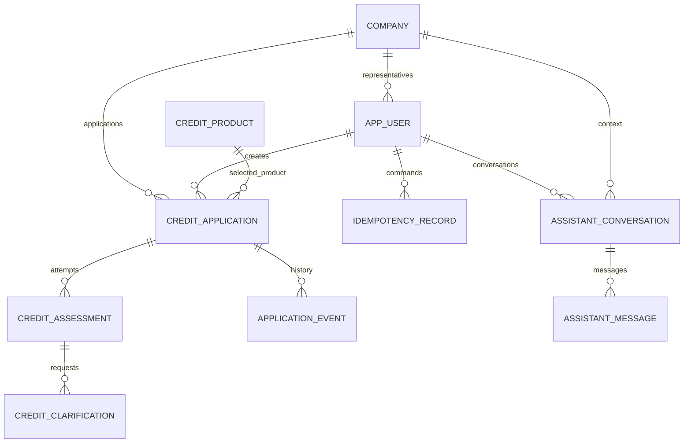

# Схема БД

Принятые решения для MVP, 23.10.2026. PostgreSQL, 10 таблиц. Документ задаёт схему для последующей реализации SQL-миграций Flyway; миграции и JPA-сущности ещё не созданы.

Основа: [архитектура](BACKEND_ARCHITECTURE.md), [сценарии](BACKEND_SCENARIOS.md), [кредитная политика](CREDIT_POLICY_AND_ML_REQUIREMENTS.md), [Backend API 0.2.0](contracts/backend.openapi.yaml), [Scoring API](contracts/scoring.openapi.yaml) и [контракт LLM](contracts/llm/README.md).

Навигация: [таблицы](#3-таблицы), [JSONB](#4-содержимое-jsonb), [ключи и индексы](#5-ключи-ограничения-и-индексы), [транзакции](#6-транзакции-и-фоновая-обработка).

## 1. Состав схемы

| Таблица | Назначение |
|---|---|
| `company` | Профиль компании |
| `app_user` | Представитель компании |
| `credit_product` | Продукт и его текущие условия |
| `credit_application` | Текущая анкета и состояние заявки |
| `credit_assessment` | Одна попытка рассмотрения, её снимок, обработка и результат |
| `credit_clarification` | Вопрос об уточнении и один принятый ответ |
| `application_event` | История переходов состояния заявки |
| `idempotency_record` | Результаты команд для безопасных повторов |
| `assistant_conversation` | Диалог с помощником |
| `assistant_message` | Сообщения диалога |

Условия хранятся в `credit_product`; отдельной `product_terms` нет. Каждая попытка сохраняет рассмотренные условия в собственном снимке. Отдельный архив всех редакций каталога не ведётся.

Попытка сама является заданием на обработку: очередь представлена ожидающими строками `credit_assessment`. Отдельной `processing_job` и Kafka в MVP нет.

Диаграмма показывает основные связи. Дополнительно заявка ссылается на последнюю попытку, попытка — на предыдущую, уточнение — на попытку, созданную с ответом, сообщение — на вопрос, которому оно отвечает.

## 2. Типы и общие правила

| Данные | PostgreSQL | Правило |
|---|---|---|
| Идентификатор | `uuid` | PK, кроме `credit_product.code`; в Java `UUID` |
| Код продукта | `varchar(64)` | Стабильный код, без ограничения каталога двумя значениями |
| Деньги | `numeric(14,2)` | RUB, `0..999999999999.99`; в Java `BigDecimal` |
| Годовая ставка | `numeric(5,2)` | Проценты, `0..999.99` |
| Риск и порог | `numeric` | Конечное число `[0,1]`, без округления перед сравнением |
| Версия и порядок сообщений | `bigint` | В пределах `0..9007199254740991`; номера сообщений начинаются с 1 |
| Номер попытки / срок | `integer` | Положительный номер; срок в месяцах `1..600` |
| Момент события | `timestamptz` | В Java `Instant`, в API UTC с `Z` |
| Календарная дата | `date` | В Java `LocalDate` |
| Состояние / код | `varchar` | Ограниченные значения через `CHECK`; состояния в Java — enum со строковым хранением |
| Документ | `jsonb` | Версионированный типизированный объект Java |

`Да` в колонке NULL означает допустимый `NULL`. Все остальные поля обязательны. Строки с содержимым не могут быть пустыми или состоять только из пробелов. Денежные диапазоны проверяются через ограничение с обеими границами, исключающее также `NaN`. Лишние десятичные знаки отклоняются до записи, поскольку `numeric(p,s)` может округлить вход.

Связи защищаются FK. Удаление компаний, представителей, продуктов, заявок, попыток и сообщений, на которые есть ссылки, ограничено через `RESTRICT`/`NO ACTION`. Каскадного удаления кредитной истории нет; продукт выводится из каталога через `active=false`.

## 3. Таблицы

### 3.1. `company` — профиль бизнеса

| Поле | Тип | NULL | Смысл |
|---|---|---|---|
| `id` | `uuid` | Нет | PK |
| `name` | `varchar(300)` | Нет | Название |
| `legal_form` | `varchar(16)` | Нет | `IP` или `OOO` |
| `registration_date` | `date` | Нет | Исходная дата для расчёта возраста бизнеса |
| `created_at`, `updated_at` | `timestamptz` | Нет | Время создания и изменения |

Демопрофиль содержит историю за весь согласованный финансовый период. Сам возраст компании не подтверждает полноту этой истории.

### 3.2. `app_user` — представитель

| Поле | Тип | NULL | Смысл |
|---|---|---|---|
| `id` | `uuid` | Нет | PK |
| `company_id` | `uuid` | Нет | FK → `company.id` |
| `display_name` | `varchar(200)` | Нет | Отображаемое имя |
| `created_at` | `timestamptz` | Нет | Время создания |

В MVP представитель связан с одной компанией. Регистрации, пароля и таблиц JWT нет. Сессия хранится в памяти приложения; после перезапуска создаётся заново для того же демоаккаунта. Для проверок доступа нужны два синтетических пользователя разных компаний.

### 3.3. `credit_product` — продукт и текущие условия

| Поле | Тип | NULL | Смысл |
|---|---|---|---|
| `code` | `varchar(64)` | Нет | PK: `WORKING_CAPITAL`, `EQUIPMENT` и будущие коды |
| `name` | `varchar(200)` | Нет | Название |
| `description` | `varchar(3000)` | Нет | Назначение продукта |
| `active` | `boolean` | Нет | Доступность для новых отправок |
| `terms_version` | `varchar(64)` | Нет | Версия текущих условий |
| `currency` | `varchar(3)` | Нет | `RUB` |
| `min_amount`, `max_amount` | `numeric(14,2)` | Нет | Допустимые суммы |
| `min_term_months`, `max_term_months` | `integer` | Нет | Допустимые сроки |
| `annual_rate_percent` | `numeric(5,2)` | Нет | Фиксированная ставка |
| `min_business_age_months` | `integer` | Нет | Минимальный возраст бизнеса, неотрицательный |
| `requires_equipment` | `boolean` | Нет | Обязательность данных оборудования |
| `limit_to_equipment_price` | `boolean` | Нет | Ограничение суммы стоимостью покупки |
| `disbursement_description`, `repayment_description` | `varchar(1000)` | Нет | Описание выдачи и погашения |
| `created_at`, `updated_at` | `timestamptz` | Нет | Время создания и изменения |

Ограничения: `min_amount <= max_amount`, `1 <= min_term_months <= max_term_months <= 600`; ограничение стоимостью оборудования требует `requires_equipment=true`. Код продукта неизменяем. Изменение условий и правил продукта сопровождается новым `terms_version`; старые обозначения версий не переиспользуются.

Начальные демонстрационные данные:

| Код | Сумма, ₽ | Срок, мес. | Ставка | Возраст бизнеса | Оборудование |
|---|---|---|---|---|---|
| `WORKING_CAPITAL` | 100 000–5 000 000 | 6–24 | 20% | ≥12 мес. | Оба флага `false` |
| `EQUIPMENT` | 100 000–10 000 000 | 12–60 | 18% | ≥12 мес. | Оба флага `true` |

Описания выдачи и погашения задаются по согласованию с Product/аналитиком. Эти настройки не являются действующими тарифами банка.

### 3.4. `credit_application` — текущая заявка

| Поле | Тип | NULL | Смысл |
|---|---|---|---|
| `id` | `uuid` | Нет | PK |
| `company_id` | `uuid` | Нет | FK → `company.id` |
| `created_by_user_id` | `uuid` | Нет | Представитель, создавший заявку |
| `product_code` | `varchar(64)` | Нет | FK → `credit_product.code`, неизменяемый продукт |
| `current_assessment_id` | `uuid` | Да | Последняя попытка, включая завершённую |
| `status` | `varchar(32)` | Нет | `DRAFT`, `CHECKING`, `NEEDS_INFO`, `TECHNICAL_HOLD`, `APPROVED`, `DECLINED` |
| `version` | `bigint` | Нет | `@Version`, начальное значение 0 |
| `amount` | `numeric(14,2)` | Да | Запрошенная сумма |
| `term_months` | `integer` | Да | Запрошенный срок |
| `average_monthly_inflow`, `average_monthly_outflow` | `numeric(14,2)` | Да | Среднемесячные поступления и расходы |
| `equipment_present` | `boolean` | Нет | Отличает `equipment=null` от объекта с незаполненными полями |
| `equipment_name` | `varchar(300)` | Да | Название оборудования |
| `equipment_purchase_price` | `numeric(14,2)` | Да | Стоимость оборудования |
| `reporting_period_start`, `reporting_period_end` | `date` | Нет | Границы периода включительно |
| `last_submitted_at` | `timestamptz` | Да | Время последней принятой отправки / технического повтора |
| `created_at`, `updated_at` | `timestamptz` | Нет | Время создания и изменения |

Период фиксируется сервером: 12 полных календарных месяцев перед месяцем создания черновика. Он не сдвигается при сохранении, повторной отправке и `retry`.

При `equipment_present=false` оба поля оборудования равны `NULL`. Для оборотного кредита оборудование отсутствует. Объект с двумя `NULL`-полями допустим в черновике оборудования, поэтому одного наличия названия или цены недостаточно для восстановления формы API.

В `DRAFT` попытка и `last_submitted_at` отсутствуют; в остальных состояниях присутствуют. Неполная анкета допустима в `DRAFT` и при редактировании запрошенного поля в `NEEDS_INFO`. Для `CHECKING`, `TECHNICAL_HOLD`, `APPROVED`, `DECLINED` обязательные поля заполнены, сумма положительна. Продуктовые диапазоны и зависимость от оборудования проверяются Java при отправке.

В `DRAFT`/`NEEDS_INFO` API показывает текущий продукт из каталога. В остальных состояниях продукт и условия берутся из снимка последней попытки. `allowedActions` вычисляется из доступа и состояния, в БД не хранится.

### 3.5. `credit_assessment` — попытка и её обработка

| Поле | Тип | NULL | Смысл |
|---|---|---|---|
| `id` | `uuid` | Нет | PK; `assessmentId` в обоих API |
| `application_id` | `uuid` | Нет | FK → `credit_application.id` |
| `attempt_no` | `integer` | Нет | Последовательный номер попытки, начиная с 1 |
| `previous_assessment_id` | `uuid` | Да | Предыдущая попытка этой заявки |
| `processing_status` | `varchar(16)` | Нет | `READY`, `RUNNING`, `FINISHED` |
| `outcome` | `varchar(32)` | Да | `APPROVED`, `DECLINED`, `NEEDS_INFO`, `TECHNICAL_HOLD` |
| `snapshot_schema_version` | `integer` | Нет | Положительная версия внутреннего формата снимка |
| `input_snapshot` | `jsonb` | Нет | Неизменяемые данные рассмотрения |
| `policy_version` | `varchar(64)` | Нет | Версия правил Java |
| `feature_schema_version` | `varchar(64)` | Нет | Версия признаков Scoring API |
| `expected_model_version` | `varchar(128)` | Нет | Ожидаемая версия модели |
| `actual_model_version` | `varchar(128)` | Да | Версия проверенного ответа ML |
| `risk_cutoff` | `numeric` | Нет | Закреплённый порог |
| `risk_score` | `numeric` | Да | Оценка ML; без вызова или при сбое — `NULL` |
| `result_payload` | `jsonb` | Да | Подробности завершённого результата |
| `next_run_at` | `timestamptz` | Нет | Время доступности ожидающей попытки |
| `execution_count` | `integer` | Нет | Неотрицательное число захватов обработки, начальное значение 0 |
| `lock_token` | `uuid` | Да | Токен текущего обработчика |
| `locked_until` | `timestamptz` | Да | Срок его захвата |
| `last_error_code` | `varchar(80)` | Да | Код последнего технического сбоя обработки |
| `created_at` | `timestamptz` | Нет | Время создания попытки |
| `finished_at` | `timestamptz` | Да | Время завершения |

`attempt_no` меняется при новом `submit`/`retry`. `execution_count` меняется при повторном захвате той же попытки после сбоя. Это разные счётчики.

При `READY`/`RUNNING` результат, исход и `finished_at` отсутствуют. При `FINISHED` они обязательны. `lock_token` и `locked_until` заполнены только в `RUNNING`. Оценка требует `actual_model_version`; отсутствие оценки не заменяется нулём. В одной заявке допускается не более одной `READY`/`RUNNING` попытки.

Снимок и параметры политики фиксируются при создании. После завершения попытка не изменяется; восстановление обработки меняет только рабочие поля незавершённой попытки. Политика настраивается в Java/конфигурации, отдельной таблицы политики нет.

### 3.6. `credit_clarification` — уточнение и ответ

| Поле | Тип | NULL | Смысл |
|---|---|---|---|
| `id` | `uuid` | Нет | PK; `clarificationId` в API |
| `application_id` | `uuid` | Нет | FK → `credit_application.id` |
| `source_assessment_id` | `uuid` | Нет | Попытка, завершившаяся в `NEEDS_INFO` |
| `rule_code` | `varchar(80)` | Нет | Сейчас `ZERO_INFLOW_CONFIRMATION` |
| `field_code` | `varchar(120)` | Нет | Сейчас `form.averageMonthlyInflow` |
| `message` | `varchar(1000)` | Нет | Исходный вопрос |
| `observed_value` | `numeric(14,2)` | Нет | Исходное значение, сейчас `0.00` |
| `reporting_period_start`, `reporting_period_end` | `date` | Нет | Период, к которому относится вопрос |
| `created_at` | `timestamptz` | Нет | Время создания вопроса |
| `response_type` | `varchar(32)` | Да | `CONFIRM_VALUE` или `VALUE_CORRECTED` |
| `response_comment` | `varchar(1000)` | Да | Необязательный комментарий |
| `answered_value` | `numeric(14,2)` | Да | Сохранённое значение при принятии ответа |
| `answered_by_user_id` | `uuid` | Да | FK → `app_user.id` |
| `answered_at` | `timestamptz` | Да | Время принятия ответа |
| `response_assessment_id` | `uuid` | Да | Новая попытка, созданная вместе с ответом |

Исходные поля вопроса неизменяемы. Поля ответа, кроме необязательного комментария, либо все отсутствуют, либо все заполнены; комментарий до ответа отсутствует. Один вопрос получает один принятый ответ. Отдельное поле состояния не нужно: наличие ответа определяется по `response_type`.

`CONFIRM_VALUE` требует `answered_value = observed_value = 0.00`. `VALUE_CORRECTED` требует положительного `answered_value`. Для текущего MVP значения денежные; новое правило для другого типа данных требует расширения схемы и API.

Java проверяет текущую попытку, все запрошенные вопросы и фактически сохранённую форму. Ответ на устаревший вопрос не принимается. Само редактирование поля не закрывает вопрос и не меняет его `observed_value`.

### 3.7. `application_event` — история состояний

| Поле | Тип | NULL | Смысл |
|---|---|---|---|
| `id` | `uuid` | Нет | PK |
| `application_id` | `uuid` | Нет | FK → `credit_application.id` |
| `application_version` | `bigint` | Нет | Версия заявки после перехода |
| `assessment_id` | `uuid` | Да | Связанная попытка |
| `from_status` | `varchar(32)` | Да | Предыдущее состояние; `NULL` только при создании |
| `to_status` | `varchar(32)` | Нет | Новое состояние |
| `reason_code` | `varchar(80)` | Да | Основной код причины; подробности в результате попытки |
| `actor_user_id` | `uuid` | Да | FK → `app_user.id`; `NULL` для фонового обработчика |
| `request_id` | `uuid` | Нет | Корреляция операции |
| `created_at` | `timestamptz` | Нет | Время события |

Добавляется при создании и переходах состояния в той же транзакции, что изменение заявки. Строки не перезаписываются. Обычное сохранение формы не создаёт переход; номера версий в истории могут иметь пропуски. Журнал не является очередью обработки.

### 3.8. `idempotency_record` — безопасные повторы

| Поле | Тип | NULL | Смысл |
|---|---|---|---|
| `id` | `uuid` | Нет | PK |
| `user_id`, `company_id` | `uuid` | Нет | Область текущего пользователя и компании |
| `operation` | `varchar(64)` | Нет | Версионированный код операции API |
| `resource_scope` | `varchar(128)` | Нет | ID ресурса либо `collection` при создании |
| `idempotency_key` | `uuid` | Нет | Заголовок `Idempotency-Key` |
| `request_hash` | `varchar(64)` | Нет | SHA-256 канонического представления запроса |
| `status` | `varchar(32)` | Нет | `IN_PROGRESS`, `SUCCEEDED`, `RETRYABLE_FAILURE` |
| `claim_token` | `uuid` | Да | Токен выполняющего команду обработчика |
| `locked_until` | `timestamptz` | Да | Срок захвата незавершённой команды |
| `response_status` | `smallint` | Да | HTTP-статус успешного результата |
| `response_body` | `jsonb` | Да | Исходное тело ответа |
| `response_headers` | `jsonb` | Да | Значимые заголовки, например `Location`; без cookie и секретов |
| `created_at`, `updated_at` | `timestamptz` | Нет | Время создания и изменения |
| `expires_at` | `timestamptz` | Да | Время допустимой очистки завершённой записи |

Все поля области уникальности обязательны: `user_id + company_id + operation + resource_scope + idempotency_key`. `request_hash` после первого принятия не меняется. Сессия, CSRF и `requestId` в хеш не входят.

При `SUCCEEDED` обязательны сохранённые статус `2xx`, тело, заголовки и `expires_at` не ранее чем через 24 часа после успеха. При `IN_PROGRESS` обязательны токен и срок захвата; очистка активной записи запрещена. `RETRYABLE_FAILURE` допускает повтор того же запроса; успешный ответ отсутствует. После истечения захвата старый исполнитель не может зафиксировать результат.

Доступ проверяется до поиска повтора. Успешный повтор возвращается до проверок версии, текущего состояния и актуальности уточнений. Новый ключ не обходит запрет параллельных рассмотрений или генераций. Ошибка генерации LLM не фиксируется как успешный ответ; следующий вызов с тем же ключом может собрать свежий контекст.

### 3.9. `assistant_conversation` — диалог

| Поле | Тип | NULL | Смысл |
|---|---|---|---|
| `id` | `uuid` | Нет | PK |
| `user_id`, `company_id` | `uuid` | Нет | Владелец и контекст доступа |
| `next_sequence` | `bigint` | Нет | Следующий номер сообщения, начальное значение 1 |
| `active_generation_token` | `uuid` | Да | Токен единственной активной генерации |
| `generation_locked_until` | `timestamptz` | Да | Срок захвата генерации |
| `created_at`, `updated_at` | `timestamptz` | Нет | Время создания и изменения |

Токен и срок захвата либо заполнены вместе, либо отсутствуют. Привязки диалога к одной заявке нет: разрешённый контекст выбирается для каждого сообщения и проверяется Java. После истечения захвата новый вызов заменяет токен, поэтому запоздавший старый ответ не сохраняется.

### 3.10. `assistant_message` — сообщение

| Поле | Тип | NULL | Смысл |
|---|---|---|---|
| `id` | `uuid` | Нет | PK |
| `conversation_id` | `uuid` | Нет | FK → `assistant_conversation.id` |
| `sequence` | `bigint` | Нет | Порядок в диалоге, начиная с 1 |
| `role` | `varchar(16)` | Нет | `USER` или `ASSISTANT` |
| `text` | `varchar(3000)` | Нет | Обычный текст; для USER максимум 2000 символов |
| `recommended_product_code` | `varchar(64)` | Да | FK → `credit_product.code`, только для ответа ассистента |
| `reply_to_message_id` | `uuid` | Да | Вопрос USER из того же диалога |
| `generation_metadata` | `jsonb` | Да | Модель, версия промпта и схемы, параметры и использованный разрешённый контекст |
| `created_at` | `timestamptz` | Нет | Время сохранения |

У USER нет рекомендации, ссылки на вопрос и метаданных генерации. У ASSISTANT обязательны ссылка на вопрос и метаданные; рекомендация может отсутствовать. Один вопрос имеет один сохранённый ответ. Проверка роли связанного сообщения выполняется сервисом.

После валидного ответа модели вопрос и ответ сохраняются одной транзакцией с последовательными номерами. При ошибке генерации ни одно из двух сообщений не добавляется. В метаданные не записываются cookie, секреты или лишняя анкета.

## 4. Содержимое JSONB

JSONB используется для документов, читаемых целиком. Текущая анкета, состояния, связи, версии и поля управления обработкой остаются столбцами. Все документы имеют конкретные Java-типы; внутренний формат снимка не зависит напрямую от HTTP DTO.

| Столбец | Содержимое |
|---|---|
| `credit_assessment.input_snapshot` | Форма, финансовый период, нужные сведения компании, продукт с условиями и флагами, признаки скоринга с `asOfDate`, применимые подтверждения |
| `credit_assessment.result_payload` | Версионированный результат: условия и причины решения, ID созданных уточнений либо техническая ошибка |
| `idempotency_record.response_body`, `response_headers` | Исходный успешный HTTP-ответ и его значимые заголовки |
| `assistant_message.generation_metadata` | Версионированные технические сведения и контекст генерации |

Для снимка и результатов проверяется тип JSON-объекта, обязательность и схема Java-типа. В результате `NEEDS_INFO` хранятся ссылки на `credit_clarification`; исходные вопросы и ответы имеют единственный источник в этой таблице. Снимок новой попытки включает ID принятых подтверждений и их поле, значение, период. Эти сведения не добавляются в признаки Python.

GIN-индексы JSONB первоначально не создаются: API выбирает записи по обычным столбцам и затем читает документ целиком.

## 5. Ключи, ограничения и индексы

PK и `UNIQUE` уже создают индексы. Дополнительный индекс с теми же ключами не нужен.

### Уникальность и согласованность связей

| Ограничение | Назначение |
|---|---|
| `app_user UNIQUE(company_id, id)` | Опорный ключ для проверки принадлежности представителя компании через составные FK |
| `credit_assessment UNIQUE(application_id, id)` | Опорный ключ для ссылок только на попытки той же заявки |
| `credit_assessment UNIQUE(application_id, attempt_no)` | Уникальный номер попытки, чтение истории попыток |
| `credit_assessment UNIQUE(application_id) WHERE processing_status IN ('READY','RUNNING')` | Не более одной активной попытки |
| `credit_clarification UNIQUE(source_assessment_id, rule_code, field_code)` | Один вопрос правила по полю в исходной попытке; чтение её вопросов |
| `application_event UNIQUE(application_id, application_version)` | Одно событие перехода на версию заявки; порядок истории |
| `idempotency_record UNIQUE(user_id, company_id, operation, resource_scope, idempotency_key)` | Единственная команда в области ключа |
| `assistant_message UNIQUE(conversation_id, sequence)` | Порядок сообщений и чтение после `afterSequence` |
| `assistant_message UNIQUE(conversation_id, id)` | Опорный ключ для ответа в том же диалоге |
| `assistant_message UNIQUE(reply_to_message_id)` | Не более одного ответа на вопрос; `NULL` у USER не мешает другим вопросам |

Составные FK:

- В заявке `(company_id, created_by_user_id)`, в диалоге и записи команды `(company_id, user_id)` ссылаются на `app_user(company_id, id)`.
- `(id, current_assessment_id)` заявки ссылается на `credit_assessment(application_id, id)`.
- `(application_id, previous_assessment_id)` попытки и ссылки на попытки в уточнении/событии ссылаются на тот же опорный ключ. `previous_assessment_id` не может равняться собственному ID.
- `(conversation_id, reply_to_message_id)` сообщения ссылается на `assistant_message(conversation_id, id)`.

Это исключает случайные ссылки на попытку чужой заявки или сообщение другого диалога. Проверка прав пользователя всё равно выполняется сервисами. Циклический FK заявки на последнюю попытку добавляется после создания обеих таблиц; при работе сначала создаётся заявка без попытки, затем попытка и ссылка на неё в одной транзакции.

### Индексы выборок

| Таблица и ключ | Условие индекса | Запрос |
|---|---|---|
| `credit_application(company_id, created_at DESC, id DESC)` | — | Список заявок компании от новых к старым |
| `credit_assessment(next_run_at, id)` | `processing_status = 'READY'` | Очередная доступная попытка |
| `credit_assessment(locked_until)` | `processing_status = 'RUNNING'` | Истёкшие захваты обработки |
| `idempotency_record(expires_at)` | `status IN ('SUCCEEDED','RETRYABLE_FAILURE')` | Очистка завершённых записей с заданным сроком |

Для чтения карточки, текущей попытки, диалога и ключа команды достаточно PK/уникальных индексов. Индексы очереди не содержат `now()`: сравнение со временем находится в запросе.

При существенном объёме выборок по состоянию добавляется `credit_application(company_id, status, created_at DESC, id DESC)`. До измерений отдельные индексы на статус, суммы, риск и каждый FK не создаются. Индексы не решают N+1: списки читаются DTO-проекциями, карточка — с целевой загрузкой текущей попытки, без всей истории.

## 6. Транзакции и фоновая обработка

### Создание и сохранение

Создание черновика атомарно сохраняет заявку, событие создания и успешный результат команды. Сохранение формы проверяет доступ, `expectedVersion` и разрешённые поля; изменяет анкету и `version`. В `NEEDS_INFO` вопрос остаётся открытым до принятия ответа через `submit`.

### `submit`

1. Проверить доступ и идемпотентный повтор. Затем проверить состояние, версии заявки и текущих условий, полноту формы и ответы на все текущие уточнения.
2. В одной транзакции создать `credit_assessment` со снимком, параметрами политики, `processing_status=READY`, `next_run_at=now()` и новым номером попытки.
3. В этой же транзакции принять ответы на уточнения, связать их с новой попыткой, обновить заявку до `CHECKING`, её версию и `last_submitted_at`, сохранить событие и исходный ответ `202` в записи команды.

Неправильный ответ или конфликт откатывает всю операцию. Отдельного сохранения ответа до создания попытки нет. Каталог на время проверки версии и копирования условий читается согласованно, например с короткой блокировкой строки продукта; изменение условий не должно попасть между проверкой и снимком.

### Обработчик внутри Java

1. В короткой транзакции выбрать доступную `READY` попытку через `FOR UPDATE SKIP LOCKED`; поставить `RUNNING`, новый `lock_token`, срок захвата и увеличить `execution_count`.
2. Вне транзакции выполнить обязательные кредитные правила. При неподтверждённых нулевых поступлениях сформировать уточнение до вызова ML. Иначе вызвать Python по HTTP и применить порог.
3. В короткой транзакции проверить `current_assessment_id`, состояние заявки, совпадение токена и действующий срок захвата. Сохранить итог, риск при наличии, уточнения, событие и новую версию заявки; завершить попытку и очистить захват.

Успешный низкий риск даёт `APPROVED`, риск на пороге и выше — `DECLINED`. Несоответствие минимальному возрасту даёт `BUSINESS_TOO_YOUNG` без фиктивного риска. Сбой скоринга даёт `TECHNICAL_HOLD`, а не кредитный отказ.

Истёкший захват восстанавливается ограниченным числом повторных запусков той же попытки. После исчерпания лимита — `TECHNICAL_HOLD` с `PROCESSING_INTERRUPTED`. Изменение захвата выполняется условно, поэтому старый обработчик не может записать поздний результат. Одной проверки `assessmentId` для этого недостаточно.

### Продолжение после уточнения и `retry`

- Подтверждение нуля или исправление принимается обычным `submit`; создаётся новая попытка. Исходная попытка, вопрос и принятый ответ остаются в истории.
- Технический `retry` создаёт новую попытку с копией рассмотренных данных, периода, условий, применимых подтверждений и закреплённых параметров политики/модели. Меняется ID попытки, не смысл рассмотрения.
- Подтверждение переносится из предыдущего снимка только при совпадении поля, значения и периода. После изменения значения прежнее подтверждение неприменимо; произвольное старое подтверждение из истории не подбирается.
- Вопрос не повторяется после принятого подтверждения неизменного нуля. В HTTP-запросе скоринга сохраняется денежная строка `"0.00"` по Scoring API; Python преобразует её в числовой признак. Ответ и комментарий пользователя в признаки не входят; подтверждение не гарантирует одобрение.

### Чат

Короткая транзакция резервирует ключ команды и единственную генерацию в диалоге. Модель вызывается вне транзакции. После проверки ответа другая короткая транзакция проверяет оба токена и сроки захватов, выделяет два номера из `next_sequence`, сохраняет пару USER+ASSISTANT, обновляет диалог и успешный результат команды, освобождает захваты.

При ошибке модель не создаёт пару сообщений; запись команды допускает повтор того же запроса, захват диалога освобождается. При перезапуске истёкшие захваты могут быть перехвачены новым запросом. Старый ответ после перехвата не сохраняется. Успешный повтор ключа не вызывает LLM и не добавляет сообщения.

## 7. Реализация и оставшиеся входные данные

- Схема создаётся SQL-миграциями Flyway; Hibernate работает с `ddl-auto=validate`.
- Основные сущности сохраняются через JPA. Захват и восстановление попыток используют целевой SQL в коротких транзакциях, без смешивания с устаревшими объектами persistence context.
- Переход заявки, завершение попытки, уточнения и событие фиксируются атомарно. JSONB-форматы и соответствие результата исходу проверяются Java; ограничения одного ряда дублируются через `CHECK`.
- При реализации проверяются конкурирующие сохранения/отправки, повторы команд, сбои и восстановление, запоздалые ответы, доступ к чужим данным, оба ответа уточнения и перенос подтверждения при `retry`.
- До подключения ML нужны численный порог, закреплённая версия модели и подтверждение корректной обработки нуля. Их значения не выдумываются и не блокируют создание схемы. Формат таблиц уже определён.
